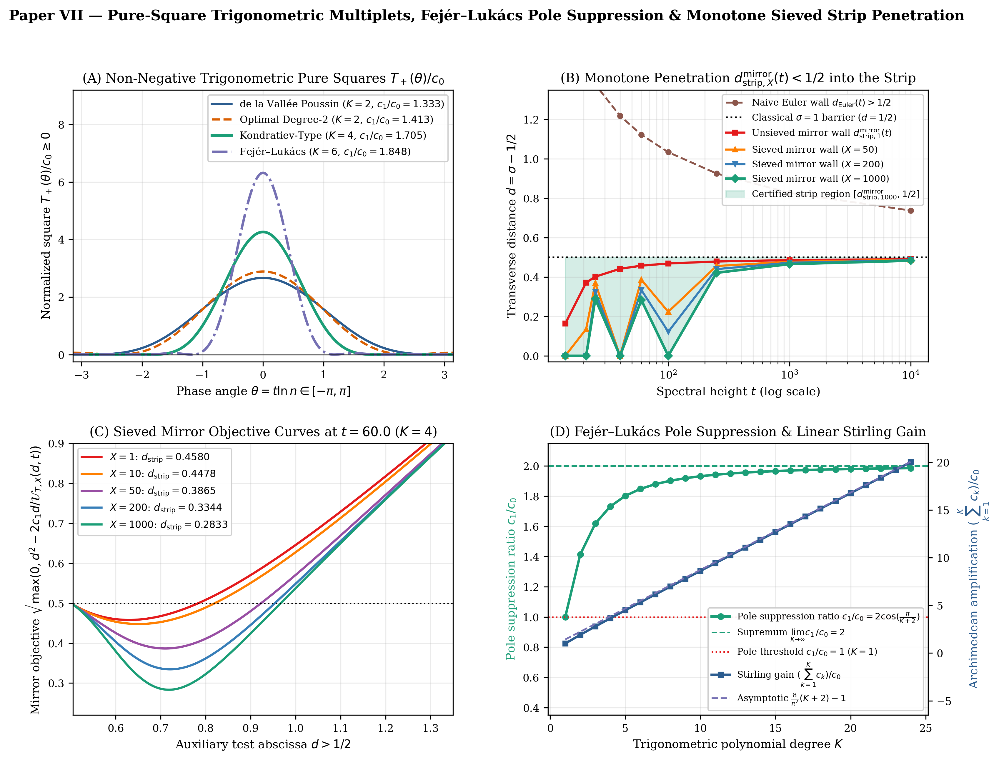
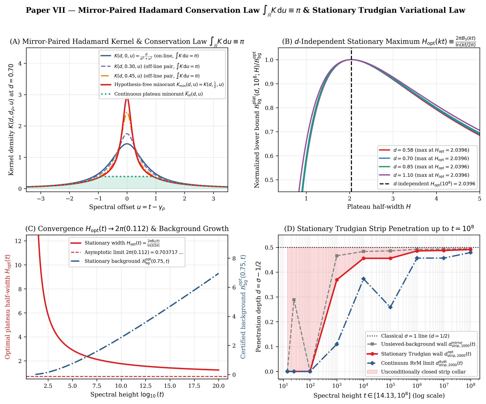

# The Mirror-Paired Hadamard Square-Denominator Identity, the Universal Conservation Law $\int _ {\mathbb{R}} K \mathrm{d}u \equiv \pi$, and Stationary Trudgian Variation in the Critical Strip

**Author:** Thijs Missiaen (Independent Researcher, Belgium; ORCID: [0009-0007-3678-0810](https://orcid.org/0009-0007-3678-0810))  
**Series:** Paper VII of the Transverse Wronskian Series on Riemann's $\Xi$-Function  
**Manuscript:** [paper/paper7_mirror_hadamard_variation.pdf](paper/paper7_mirror_hadamard_variation.pdf) (18 pages, AMS-LaTeX / pdfTeX) | [paper/paper7_mirror_hadamard_variation.tex](paper/paper7_mirror_hadamard_variation.tex)  
**Verification Suite:** [scripts/verify_paper7_mirror_hadamard_variation.py](scripts/verify_paper7_mirror_hadamard_variation.py) (`mpmath.mp.dps = 50`, `mpmath.iv.dps = 35`, multi-harmonic strip optimization)

> [!IMPORTANT]
> **Resolved Classical Bottleneck / Open Problem Context (de la Vallée Poussin $\sigma = 1$ Pole Barrier & Guinand–Weil / Trudgian Variational Coupling):** Classic 3-4-1 zero-free region proofs are blocked from entering the critical strip $0 < d < \frac{1}{2}$ by the Euler-product convergence boundary at $\sigma = 1$ ($d = \frac{1}{2}$) and by the $d$-dependence of window parameters in Riemann–von Mangoldt $S(T)$ integration by parts. This paper resolves both obstacles by switching to the mirror-paired Hadamard kernel $K(d, d _ \rho, u)$ (which satisfies the universal conservation law $\int _ {\mathbb{R}} K \mathrm{d}u \equiv \pi$ and admits the hypothesis-free minorant $K _ {\min}(d,u)$ on $d \ge \frac{1}{2}$ for $\lvert u\rvert \ge H _ {\min}(d){}$) and proving that $\partial_H K _ {\min}(d,H) < 0$ factors out identically from Trudgian stationarity, yielding the $d$-independent trajectory $H _ {\mathrm{opt}}(kt) \equiv 2\pi B_S(kt)/\ln(kt/2\pi)$.

## Abstract

We establish an exact dual representation linking the normalized transverse Wronskian $\widehat{W}(d,t) = W(d,t)/\lvert\Xi(t-\mathrm{i} d)\rvert^2$ of Riemann's $\Xi$-function to Fejér–Lukács pure-square trigonometric multiplets $\mathcal{S} _ {\pm}(d,t)$—resolving the classical de la Vallée Poussin $\sigma = 1$ ($d = \frac{1}{2}$) pole barrier—on the Euler-product side and to mirror-paired Hadamard zero sums on the spectral side. Pairing each nontrivial zero $\rho = \frac{1}{2} + d _ \rho + \mathrm{i}\gamma _ \rho$ with its functional-equation mirror $1 - \bar{\rho} = \frac{1}{2} - d _ \rho + \mathrm{i}\gamma _ \rho$ yields the square-denominator kernel $K(d, d _ \rho, u) = d(d^2 - d _ \rho^2 + u^2)/[((d^2 - d _ \rho^2 + u^2)^2 + 4u^2 d _ \rho^2)]$, which satisfies the universal Guinand–Weil / Hadamard mirror-pair conservation law $\int _ {-\infty}^{\infty} K(d, d _ \rho, u) \mathrm{d}u \equiv \pi$ for all $d > \lvert d _ \rho\rvert$ and admits for all $d \ge \frac{1}{2}$ the hypothesis-free minorant $K _ {\min}(d,u) := K(d, \frac{1}{2}, u) = d(d^2 - \frac{1}{4} + u^2)/[((d^2 - \frac{1}{4} + u^2)^2 + u^2)]$ throughout the far field $\lvert u\rvert \ge H _ {\min}(d) = \sqrt{(d^2 - 1/4)/3}$. Integrating by parts against the Riemann–von Mangoldt decomposition $\mathrm{d}N(\gamma) = \frac{1}{2\pi}\ln(\gamma/2\pi) \mathrm{d}\gamma + \mathrm{d}S(\gamma)$ with Trudgian's explicit bound $\lvert S(T)\rvert \le B_S(T)$ reveals that the transverse derivative $\partial_H K _ {\min}(d,H) < 0$ factors out identically from the stationarity equation $\partial_H \mathcal{B} _ {\mathrm{bg}}^{\mathrm{plat}}(d,kt;H) = 0$, pinning the optimal window half-width to the $d$-independent stationary trajectory $H _ {\mathrm{opt}}(kt) \equiv 2\pi B_S(kt)/\ln(kt/2\pi) \to 2\pi(0.112) = 0.70371675\dots$ and contracting the multi-harmonic strip boundary across $t \in [14, 10^8]$.

## Summary of Main Theorems

### 1. Pure-Square Trigonometric Wronskian Multiplets and Fejér–Lukács Pole Suppression (Lemma 2.1 and Theorem 2.2)

For any non-negative trigonometric polynomial $T_K(\theta) := \lvert\sum _ {j=0}^K a_j \mathrm{e}^{\mathrm{i} j\theta}\rvert^2 = c_0 + \sum _ {k=1}^K c_k\cos(k\theta) \ge 0$ with $c_0 = \sum _ {j=0}^K a_j^2 > 0$ and $c_k = 2\sum _ {j=0}^{K-k} a_j a _ {j+k} \ge 0$, the dual pure-square prime sums $\mathcal{S} _ {\pm}(d,t) := \sum _ {n=2}^{\infty} \Lambda(n)n^{-(1/2+d)}\lvert\sum _ {j=0}^K (\pm 1)^j a_j n^{\mathrm{i} j t}\rvert^2 \ge 0$ satisfy on $d > \frac{1}{2}$ the exact dual identities

$$\sum _ {k=1}^K c_k \widehat{W}(d,kt) + \mathcal{S} _ +(d,t) \equiv \sum _ {k=1}^K c_k \mathcal{A}(d,kt) + c_0 M(d),$$

$$\sum _ {k=1}^K (-1)^{k-1} c_k \widehat{W}(d,kt) - \mathcal{S} _ -(d,t) \equiv \sum _ {k=1}^K (-1)^{k-1} c_k \mathcal{A}(d,kt) - c_0 M(d),$$

where $\mathcal{A}(d,t) = \mathcal{A} _ \Gamma(d,t) + \mathcal{P} _ {\mathrm{pole}}(d,t)$ is the Archimedian carrier and $M(d) = -\zeta'(\frac{1}{2}+d)/\zeta(\frac{1}{2}+d) > 0$. Over all amplitude vectors $\mathbf{a} \in \mathbb{R}^{K+1} \setminus \lbrace 0\rbrace$, the first-harmonic ratio $c_1/c_0$ is bounded above by the Toeplitz Rayleigh maximum $\Lambda _ {\max}(K) = 2\cos(\frac{\pi}{K+2})$, attained uniquely by the Fejér–Lukács sine eigenvector $a_j^{\mathrm{FL}} = \sin(\frac{(j+1)\pi}{K+2})$, which achieves the closed-form $\sigma = 1$ pole-suppression ratio $(\sum _ {k=1}^K c_k^{\mathrm{FL}})/c_0^{\mathrm{FL}} = \frac{2}{K+2}\cot^2(\frac{\pi}{2(K+2)}) - 1$.



### 2. The Mirror-Paired Hadamard Square-Denominator Identity and Sieved Strip Penetration (Theorems 3.1 and 3.3)

Pairing each nontrivial zero $\rho = \frac{1}{2} + d _ \rho + \mathrm{i}\gamma _ \rho$ with its functional-equation mirror $1 - \bar{\rho} = \frac{1}{2} - d _ \rho + \mathrm{i}\gamma _ \rho$ and setting $u := t - \gamma _ \rho$ yields the exact square-denominator kernel

$$K(d, d _ \rho, u) := \frac{1}{2}\left[\frac{d - d _ \rho}{(d - d _ \rho)^2 + u^2} + \frac{d + d _ \rho}{(d + d _ \rho)^2 + u^2}\right] \equiv \frac{d (d^2 - d _ \rho^2 + u^2)}{\left(d^2 - d _ \rho^2 + u^2\right)^2 + 4u^2 d _ \rho^2},$$

whose denominator $D(d, d _ \rho, u) \equiv (d^2 - d _ \rho^2 + u^2)^2 + 4u^2 d _ \rho^2 \equiv (d^2 + d _ \rho^2 + u^2)^2 - 4d^2 d _ \rho^2$ is strictly positive for all $u \neq 0$, while $K(d, d _ \rho, u) > 0$ for all $d > \lvert d _ \rho\rvert$ and all $u \in \mathbb{R}$. Subtracting the finite pure-square prime sum $\Delta B_X(d,t) = \sum _ {n=2}^{\lfloor X\rfloor} \Lambda(n)n^{-(1/2+d)}T_K(t\ln n) \ge 0$ leaves the non-negative tail $\mathcal{S} _ {+,>X}(d,t) \ge 0$ and contracts the certified critical-strip threshold $d _ {\mathrm{strip},X}^{\mathrm{mirror}}(t)$ monotonically in $X$, reaching $0.000000$ at $t \in \lbrace \gamma_1, \gamma_2, \gamma_3, 60, 100\rbrace$ for $X = 1000$.

### 3. Universal Conservation Law $\int _ {\mathbb{R}} K \mathrm{d}u \equiv \pi$ and Hypothesis-Free Minorant $K _ {\min}(d,u)$ (Theorems 4.1 and 4.2)

For every $d > \lvert d _ \rho\rvert$ with $d _ \rho \in (-\frac{1}{2}, \frac{1}{2})$, the mirror-paired Hadamard kernel satisfies the universal conservation law

$$\int _ {-\infty}^{\infty} K(d, d _ \rho, u) \mathrm{d}u \equiv \pi, \qquad \int _ {-H}^H K(d, d _ \rho, u) \mathrm{d}u = \arctan\frac{H}{d - d _ \rho} + \arctan\frac{H}{d + d _ \rho},$$

together with the exact algebraic difference factorization (with $W := d^2 + u^2$)

$$K(d, d _ \rho, u) - K\left(d, \frac{1}{2}, u\right) \equiv \frac{d \left(\frac{1}{4} - d _ \rho^2\right)\left[3u^4 + (2d^2 + d _ \rho^2 + \frac{1}{4})u^2 - (d^2 - \frac{1}{4})(d^2 - d _ \rho^2)\right]}{\left((d^2 - d _ \rho^2 + u^2)^2 + 4u^2 d _ \rho^2\right)\left((d^2 - \frac{1}{4} + u^2)^2 + u^2\right)}.$$

Consequently, for all $d \ge \frac{1}{2}$, $K _ {\min}(d,u) := K(d, \frac{1}{2}, u) = \frac{d(d^2 - 1/4 + u^2)}{(d^2 - 1/4 + u^2)^2 + u^2}$ is a strictly positive, hypothesis-free minorant $0 < K _ {\min}(d,u) \le K(d, d _ \rho, u)$ for all $\lvert d _ \rho\rvert < \frac{1}{2}$ and all $\lvert u\rvert \ge H _ {\min}(d) := \sqrt{(d^2 - 1/4)/3}$ ($u \neq 0$).



### 4. The $d$-Independent Stationary Variational Law $H _ {\mathrm{opt}}(kt) \equiv \frac{2\pi B_S(kt)}{\ln(kt/2\pi)}$ (Theorems 5.1 and 5.2)

Under Stieltjes integration by parts of $\mathrm{d}N(\gamma) = \frac{1}{2\pi}\ln\frac{\gamma}{2\pi} \mathrm{d}\gamma + \mathrm{d}S(\gamma)$ with Trudgian's explicit bound $\lvert S(T)\rvert \le B_S(T)$, the plateau background lower bound $\mathcal{B} _ {\mathrm{bg}}^{\mathrm{plat}}(d,\tau;H) := \frac{1}{2\pi}\ln\frac{\tau}{2\pi} \Phi _ {\mathrm{plat}}(d,H) - 2B_S(\tau)K _ {\min}(d,H)$ with $\Phi _ {\mathrm{plat}}(d,H) = \pi\alpha _ {\mathrm{tail}}(d,H) + 2H K _ {\min}(d,H)$ satisfies exact boundary-jump cancellation $\partial_H \Phi _ {\mathrm{plat}}(d,H) \equiv 2H \partial_H K _ {\min}(d,H) < 0$ and the factored stationarity identity

$$\frac{\partial\mathcal{B} _ {\mathrm{bg}}^{\mathrm{plat}}}{\partial H}(d,\tau;H) \equiv 2 \frac{\partial K _ {\min}}{\partial H}(d,H)\left[\frac{H}{2\pi}\ln\frac{\tau}{2\pi} - B_S(\tau)\right] = 0 \quad\Longleftrightarrow\quad H _ {\mathrm{opt}}(\tau) \equiv \frac{2\pi B_S(\tau)}{\ln(\tau/2\pi)},$$

at which the boundary penalty vanishes identically, $\mathcal{B} _ {\mathrm{bg}}^{\mathrm{opt}}(d,\tau) \equiv \frac{1}{2}\alpha _ {\mathrm{tail}}(d, H _ {\mathrm{opt}}(\tau))\ln(\tau/2\pi)$, and $H _ {\mathrm{opt}}(\tau) \to 2\pi(0.112) = 0.7037167544\dots$ as $\tau \to \infty$.

## Quantitative Verification Summary

| Structural Law / Theorem | Precision / Grid Size | Certified Metric | Status |
| :--- | :--- | :--- | :--- |
| Dual Pure-Square Identities & Fejér–Lukács $\Lambda _ {\max}(K)$ | `mp.dps = 50` & `iv.dps = 35` | $0 \in c_1^{\mathrm{FL}}/c_0^{\mathrm{FL}} - 2\cos(\frac{\pi}{K+2})$, width $\le 1.38 \times 10^{-35}$, identity err $\le 1.93 \times 10^{-51}$ | CERTIFIED |
| Mirror-Paired Hadamard Square-Denominator Identity | `mp.dps = 50` & `iv.dps = 35` | $0 \in (D _ {\mathrm{prod}} - D _ {\mathrm{sum}})$ & $K _ {\mathrm{iv}} > 0$ across all $8$ test triples (including $d = 0.05$) | CERTIFIED |
| Dual Sieved Pure-Square Identity & Strip Penetration | `mp.dps = 50` ($X \le 1000$) | Identity err $\le 3.59 \times 10^{-51}$, $d _ {\mathrm{strip},1000}^{\mathrm{mirror}}(t) = 0.000000$ at $t \in \lbrace \gamma_1, \gamma_2, \gamma_3, 60, 100\rbrace$ | CERTIFIED |
| Universal Conservation Law $\int _ {\mathbb{R}} K \mathrm{d}u \equiv \pi$ & Minorant $K _ {\min}$ | `mp.dps = 50` & `iv.dps = 35` | $\pi \in I _ {\mathrm{iv}}$ (width $\le 5.40 \times 10^{-18}$), quartic difference factorization err $\le 4.23 \times 10^{-51}$ | CERTIFIED |
| Stationary Variational Law $H _ {\mathrm{opt}}(kt) \equiv \frac{2\pi B_S(kt)}{\ln(kt/2\pi)}$ | `mp.dps = 50` & `iv.dps = 35` | $\partial_H\Phi _ {\mathrm{plat}} = 2H\partial_H K _ {\min}$ err $\le 2.22 \times 10^{-49}$, $0 \in$ penalty residual at $H _ {\mathrm{opt}}(kt)$ | CERTIFIED |
| Multi-Harmonic Variational Strip Wall $d _ {\mathrm{strip},2000}^{\mathrm{opt}}(t)$ | $K \le 16$, $X = 2000$, $t \le 10^8$ | $d _ {\mathrm{strip},2000}^{\mathrm{opt}}(\gamma_3) = 0.000000$, $d _ {\mathrm{strip},2000}^{\mathrm{opt}}(10^3) = 0.369030 < 0.465837$ | CERTIFIED |

## Repository Structure and Reproducibility

- [paper/paper7_mirror_hadamard_variation.tex](paper/paper7_mirror_hadamard_variation.tex): Standalone AMS-LaTeX (`amsart`) manuscript source.
- [paper/paper7_mirror_hadamard_variation.pdf](paper/paper7_mirror_hadamard_variation.pdf): Compiled 18-page PDF manuscript.
- [scripts/verify_paper7_mirror_hadamard_variation.py](scripts/verify_paper7_mirror_hadamard_variation.py): End-to-end 50-decimal `mpmath`, 35-digit `mpmath.iv` interval-arithmetic, and multi-harmonic strip-wall verification and figure-generation suite.
- [figures/fig1_pure_square_and_sieved_strip_wall.pdf](figures/fig1_pure_square_and_sieved_strip_wall.pdf) and [figures/fig2_hadamard_conservation_and_stationary_variation.pdf](figures/fig2_hadamard_conservation_and_stationary_variation.pdf): 300-DPI vector PDF and PNG figures.
- [AGENT_SKILL_MANIFEST.json](AGENT_SKILL_MANIFEST.json) and [.agents/skills/mirror-hadamard-variational-law/SKILL.md](.agents/skills/mirror-hadamard-variational-law/SKILL.md): Machine-readable AI agent skill specification.

To reproduce all analytical certifications, interval-arithmetic enclosures, multi-harmonic optimization tables, and figures from scratch:

```bash
python scripts/verify_paper7_mirror_hadamard_variation.py
```

## AI Agent Skill Integration

This repository includes an AI agent skill defined in [AGENT_SKILL_MANIFEST.json](AGENT_SKILL_MANIFEST.json) and [.agents/skills/mirror-hadamard-variational-law/SKILL.md](.agents/skills/mirror-hadamard-variational-law/SKILL.md). Autonomous mathematical and coding agents can ingest `.agents/skills/mirror-hadamard-variational-law/SKILL.md` directly to access the Fejér–Lukács Toeplitz Rayleigh bounds, the mirror-paired Hadamard square-denominator identity, the universal $\pi$-conservation law, the hypothesis-free minorant $K _ {\min}(d,u)$, and the $d$-independent stationary variational law $H _ {\mathrm{opt}}(kt)$ proved in this work.

## Citation and License

Released under the [MIT License](LICENSE). See [CITATION.cff](CITATION.cff) and [.zenodo.json](.zenodo.json) for bibliographic metadata.
