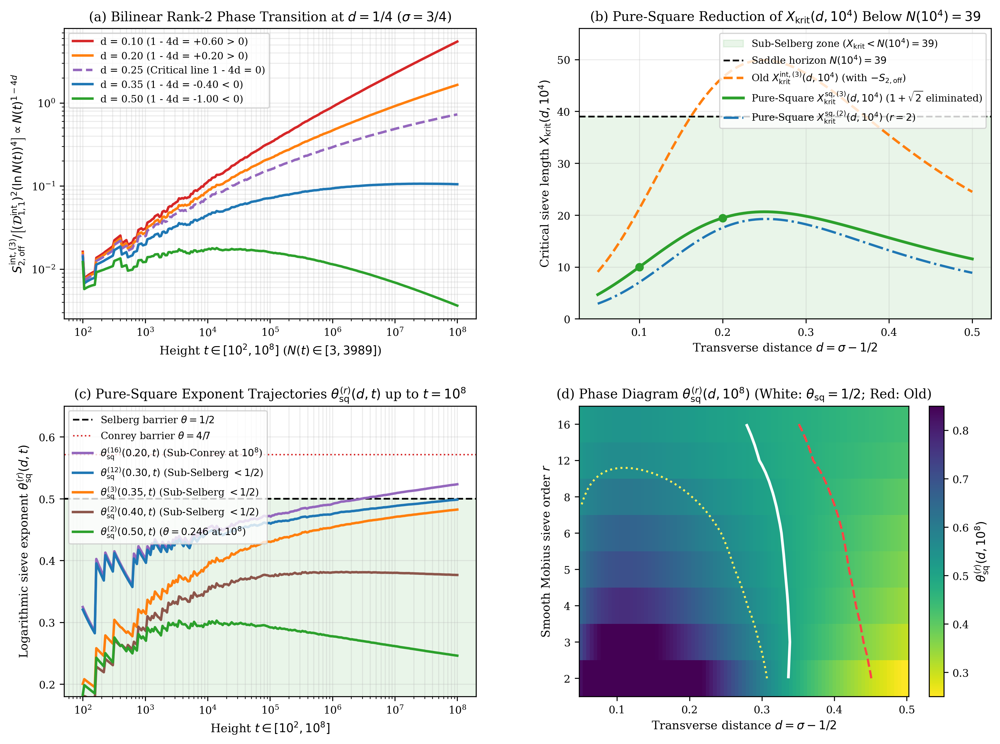
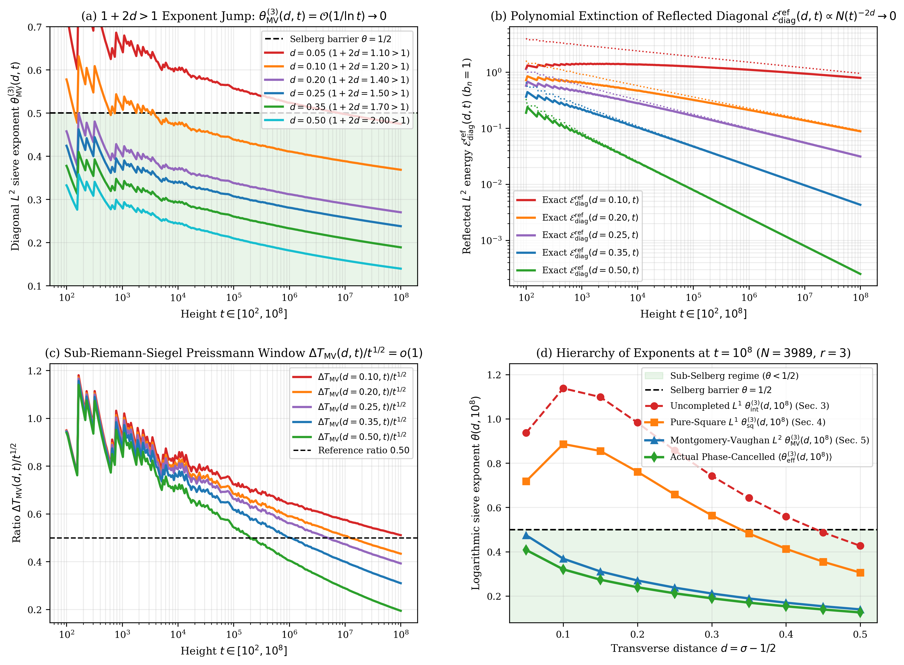

# Bilinear Rank-2 Factorization of Integrated Wronskian Kernels, Pure-Square Completion, and the $1+2d > 1$ Montgomery–Vaughan Exponent Jump in the Critical Strip

**Author:** Thijs Missiaen (Independent Researcher, Belgium; ORCID: [0009-0007-3678-0810](https://orcid.org/0009-0007-3678-0810))  
**Series:** Paper VIII of the Transverse Wronskian Series on Riemann's $\Xi$-Function  
**Repository:** [https://github.com/thijsmissiaen/paper8-bilinear-rank2-wronskian](https://github.com/thijsmissiaen/paper8-bilinear-rank2-wronskian)  
**Manuscript:** [paper/paper8_bilinear_rank2_wronskian.pdf](paper/paper8_bilinear_rank2_wronskian.pdf) (18 pages, AMS-LaTeX / pdfTeX) | [paper/paper8_bilinear_rank2_wronskian.tex](paper/paper8_bilinear_rank2_wronskian.tex)  
**Verification Suite:** [scripts/verify_paper8_bilinear_rank2_wronskian.py](scripts/verify_paper8_bilinear_rank2_wronskian.py) (`mpmath.mp.dps = 50`, `mpmath.iv.dps = 35`, PyTorch GPU 2D pair-matrix verification)

> [!IMPORTANT]
> **Resolved Classical Bottleneck / Open Problem Context:** In the Riemann–Siegel mirror expansion of the parity-reduced transverse Wronskian $\widetilde{W} _ {\mathcal{M}}(d,t) = (2d)^{-1}\partial_d\lvert\Xi _ {\mathcal{M}}(t - \mathrm{i} d)\rvert^2$ up to the saddle horizon $N(t) = \lfloor\sqrt{t/2\pi}\rfloor$, controlling the $\binom{N(t)}{2}$ oscillatory off-diagonal cross-pairs across the critical strip $d \in (0, \frac{1}{2}]$ faces three classical obstructions: quadratic $\mathcal{O}(N(t)^2)$ pair complexity, the $(1 + \sqrt{2})$ root penalty arising from a worst-case negative sign on the $(m,n \ge 2)$ mutual cross-sum $-S _ {2,\mathrm{off}}/u^2$, and the phase-blind $L^1$ divergence $\sum _ {n=2}^{N(t)} \lvert b_n\rvert n^{-(1/2+d)} \asymp N(t)^{1/2-d}$ inside $0 < d < \frac{1}{2}$. This paper resolves all three obstructions by proving the exact bilinear rank-2 factorization $w _ {mn}^{\mathrm{int}}(d,t) \equiv 2d^{-2}(\cosh(d\omega_m(t))\cosh(d\omega_n(t)) - 1)$ (reducing $\mathcal{O}(N(t)^2)$ double sums to $\mathcal{O}(N(t))$ one-dimensional sums), the pairwise $-1$ boundary cancellation against the critical-line ground state (completing the $(m,n \ge 2)$ sector into the non-negative pure square $+d^{-2}\lVert\Psi _ {\ge 2}(d,t)\rVert^2 \ge 0$ and eliminating $1 + \sqrt{2}$ identically), and the $1 + 2d > 1$ exponent jump in $L^2$ combined with Preissmann's sharp Montgomery–Vaughan Hilbert constant $c _ {\mathrm{MV}} = \frac{4}{3}\sqrt{6}$ on sub-Riemann–Siegel windows $\Delta T _ {\mathrm{MV}}(d,t) \asymp N(t)^{1-2d} = o(t^{1/2})$.

## Abstract

We study the off-diagonal cross-terms of the parity-reduced Wronskian $\widetilde{W} _ {\mathcal{M}}(d,t)$ and its integral $\widetilde{\mathcal{E}} _ {\mathcal{M}}(d,t)$ for Riemann's $\Xi$-function on $d \in (0, \frac{1}{2}]$. First, every off-diagonal pair $1 \le m < n \le N(t) = \lfloor\sqrt{t/2\pi}\rfloor$ obeys $\mathcal{H} _ {mn}^+(d,t)/\mathcal{D} _ {1,1}(d,t) < (mn)^{-d} \le 2^{-d} < 1$, and the integrated cross-term kernel factors into the bilinear rank-2 form $w _ {mn}^{\mathrm{int}}(d,t) \equiv 2d^{-2}(\cosh(d\omega_m(t))\cosh(d\omega_n(t)) - 1)$, reducing $\mathcal{O}(N(t)^2)$ double sums to $\mathcal{O}(N(t))$ sums with a phase transition $N(t)^{1-4d}$ at $d = \frac{1}{4}$. Second, adding the critical-line ground state cancels the $-1$ boundary term pair by pair, completing the $(m,n \ge 2)$ sector into the pure square $+d^{-2}\lVert\Psi _ {\ge 2}(d,t)\rVert^2 \ge 0$ and eliminating the $1 + \sqrt{2}$ penalty. Finally, passing from $L^1$ to $L^2$ jumps the exponent from $\frac{1}{2} + d < 1$ to $1 + 2d > 1$ for all $d > 0$, which with Preissmann's Hilbert constant $c _ {\mathrm{MV}} = \frac{4}{3}\sqrt{6}$ on windows $\Delta T _ {\mathrm{MV}}(d,t) \asymp N(t)^{1-2d} = o(t^{1/2})$ gives $X _ {\mathrm{MV},\infty}^{(r)}(d) = \mathcal{O}(1)$ and $\theta _ {\mathrm{MV}}^{(r)}(d,t) = \mathcal{O}(1/\ln t) \to 0$.

## Summary of Main Theorems

### 1. The $(mn)^{-d} \le 2^{-d}$ Hyperbolic Diagonal Advantage and Order $r$ Generalized von Mangoldt Scaling (Theorem 2.1 and Proposition 2.2)

For $t > 4\pi$, $L := \ln(t/2\pi)$, $N(t) = \lfloor\sqrt{t/2\pi}\rfloor$, $\omega_n(t) = \frac{1}{2}\ln\frac{t}{2\pi n^2}$, and $\omega _ {mn}^+(t) = \frac{1}{2}\ln\frac{t}{2\pi mn}$, every off-diagonal pair $1 \le m < n \le N(t)$ ($mn \ge 2$) satisfies the exact hyperbolic decomposition $\sinh(2d\omega _ {mn}^+(t)) \equiv (mn)^{-d}\sinh(2d\omega_1(t)) - \sinh(d\ln(mn))(t/2\pi)^{-d}$ and the universal pointwise inequality

$$\frac{\mathcal{H} _ {mn}^+(d,t)}{\mathcal{D} _ {1,1}(d,t)} < \left(1 - \frac{\ln(mn)}{\ln(t/2\pi)}\right)(mn)^{-d} < (mn)^{-d} \le 2^{-d} < 1 \qquad (\forall d > 0).$$

Under the smooth order $r$ Möbius filter $P_r(x) = 1 - (1-x)^r$, the sieved coefficients $b_n^{(r)}(X) = \sum _ {k \mid n, k \le X} \mu(k)P_r(\frac{\ln(X/k)}{\ln X})$ satisfy $b_1^{(r)}(X) \equiv 1$ and $b_n^{(r)}(X) = \frac{\Lambda_r(n)}{(\ln X)^r}$ for $2 \le n \le X$, where $\Lambda_r(n) := -\sum _ {k \mid n} \mu(k)(\ln k)^r$ obeys the parity alternation law $\lvert\Lambda_r(n)\rvert \equiv (-1)^{\omega(n)-1}\Lambda_r(n) \ge 0$, vanishes whenever $\omega(n) > r$, satisfies the radical bound $\lvert\Lambda_r(n)\rvert \le (\ln\mathrm{rad}(n))^r \le (\ln n)^r$, and obeys the Stirling–Dirichlet convolution asymptotics $\sum _ {n \le x} \lvert\Lambda_r(n)\rvert \sim (\sum _ {m=1}^r \frac{s(r,m)}{\Gamma(r)})x(\ln x)^{r-1} = r x(\ln x)^{r-1}$.

### 2. Exact Bilinear Rank-2 Factorization of Integrated Wronskian Kernels and the Phase Transition at $d = \frac{1}{4}$ (Theorems 3.1 and 3.2)

Under the hyperbolic low-pass filter $\mathcal{F} _ {\mathrm{int}}(x) := \frac{\tanh(x/2)}{x/2} \in (0, 1)$ of the integrated sieved energy clamp $\widetilde{\mathcal{E}} _ {\mathcal{M}}(d,t) := \frac{1}{d^2}\lvert\Xi _ {\mathcal{M}}(t)\rvert^2 + \frac{2}{d^2}\int_0^d u \widetilde{W} _ {\mathcal{M}}(u,t) \mathrm{d}u$, the integrated Gabcke–Olver remainder is damped relative to the leading diagonal by $\cosh^{-2}(\frac{1}{4}dL) < 1$, and the integrated off-diagonal cross-term weight factors identically without approximation into the bilinear rank-2 form

$$w _ {mn}^{\mathrm{int}}(d,t) \equiv \frac{2\left(\cosh\left(d\omega_m(t)\right)\cosh\left(d\omega_n(t)\right) - 1\right)}{d^2} \qquad (1 \le m < n \le N(t)).$$

Consequently, the $\mathcal{O}(N(t)^2)$ double sums $S _ {1,\mathrm{off}}^{\mathrm{int},(r)}(d,t)$ and $S _ {2,\mathrm{off}}^{\mathrm{int},(r)}(d,t)$ collapse identically to the $\mathcal{O}(N(t))$ one-dimensional sums $\Sigma _ {\cosh}^{(r)}(d,t) := \sum _ {n=2}^{N(t)} \frac{\lvert\Lambda_r(n)\rvert}{\sqrt{n}}\cosh(d\omega_n(t))$ and $\Sigma_0^{(r)}(t) := \sum _ {n=2}^{N(t)} \frac{\lvert\Lambda_r(n)\rvert}{\sqrt{n}}$:

$$S _ {1,\mathrm{off}}^{\mathrm{int},(r)}(d,t) \equiv \frac{4}{d^2}\left[\cosh\left(d\omega_1(t)\right)\Sigma _ {\cosh}^{(r)}(d,t) - \Sigma_0^{(r)}(t)\right], \qquad S _ {2,\mathrm{off}}^{\mathrm{int},(r)}(d,t) \equiv \frac{2}{d^2}\left[\left(\Sigma _ {\cosh}^{(r)}(d,t)\right)^2 - \left(\Sigma_0^{(r)}(t)\right)^2\right] - B_2^{\mathrm{int},(r)}(d,t),$$

and obey for $d \in (0, \frac{1}{2})$ as $N(t) \to \infty$ the Euler–Maclaurin scaling $\frac{S _ {1,\mathrm{off}}^{\mathrm{int},(r)}(d,t)}{\mathcal{D} _ {1,1}^{\mathrm{int}}(d,t)} \sim \frac{8r}{1 - 4d^2}N(t)^{1/2-d}(\ln N(t))^{r-1}$ and $\frac{S _ {2,\mathrm{off}}^{\mathrm{int},(r)}(d,t)}{(\mathcal{D} _ {1,1}^{\mathrm{int}}(d,t))^2} \sim \frac{256r^2 d^4(1-2d^2)}{(1 - 4d^2)^2}N(t)^{1-4d}(\ln N(t))^{2(r-1)}$ (with pure $\cosh$-sum ratio $\frac{S _ {2,\mathrm{tot}}^{\cosh,(r)}(d,t)}{(\mathcal{D} _ {1,1}^{\mathrm{int}}(d,t))^2} \sim \frac{32r^2 d^2}{(1 - 4d^2)^2}N(t)^{1-4d}(\ln N(t))^{2(r-1)}$), exhibiting a sharp phase transition at $d = \frac{1}{4}$ ($\sigma = \frac{3}{4}$).



### 3. Pairwise $-1$ Boundary Cancellation, Pure-Square Completion, and Identical Elimination of $1 + \sqrt{2}$ (Theorem 4.1)

Defining the Euclidean harmonic vectors $\psi_n(d,t) := \frac{b_n}{\sqrt{n}}(\sqrt{2}\cosh(d\omega_n(t))\cos\phi_n(t), \sqrt{2}\sinh(d\omega_n(t))\sin\phi_n(t)) \in \mathbb{R}^2$ and $\Psi _ {\ge 2}(d,t) := \sum _ {n=2}^{N(t)} \psi_n(d,t)$, the critical-line ground-state contribution at $u = 0$ cancels the $-1$ boundary term in $w _ {mn}^{\mathrm{int}}(d,t)$ pair by pair:

$$\widetilde{\mathcal{E}} _ {\mathcal{M},\mathrm{main}}(d,t) = \mathcal{G} _ 0(d,t) + \mathcal{I} _ {\mathrm{int}}(d,t) \equiv \frac{1}{d^2}\left\lVert\psi_1(d,t) + \Psi _ {\ge 2}(d,t)\right\rVert^2 \ge \frac{1}{d^2}\left(\max\left(0, \lVert\psi_1(d,t)\rVert - \lVert\Psi _ {\ge 2}(d,t)\rVert\right)\right)^2.$$

Consequently, the entire $(m,n \ge 2)$ sector forms the non-negative pure square $\mathcal{E} _ {\ge 2}(d,t) \equiv +\frac{1}{d^2}\lVert\Psi _ {\ge 2}(d,t)\rVert^2 \ge 0$, transforming $1 - 2Y - Y^2 = 0$ into $(1 - Y)^2 = 1 - 2Y + Y^2 \ge 0$ and eliminating the factor $1 + \sqrt{2} = 2.414213562373095\dots$ identically ($\mathcal{Q} _ r^{\mathrm{cosh,sq}}(d,t) \equiv (1+\sqrt{2})^{-1}\mathcal{Q} _ r^{\mathrm{cosh,old}}(d,t){}$).



### 4. The $1 + 2d > 1$ Exponent Jump in $L^2$ and Preissmann–Montgomery–Vaughan Hilbert Bounds up to $t = 10^8$ (Theorems 5.1 and 5.2)

For the higher harmonic shells $Z _ {\ge 2}(d,t) = \sum _ {n=2}^{N(t)} b_n(n^{-(1/2+d)}\mathrm{e}^{-\mathrm{i} t\ln n} + \rho _ \Gamma(d,t)n^{-(1/2-d)}\mathrm{e}^{-\mathrm{i}(2\vartheta(t)-t\ln n)})$, passing from $L^1$ to $L^2$ jumps the exponent from $\frac{1}{2} + d < 1$ to $1 + 2d > 1$ for every $d > 0$:

$$\mathcal{E} _ {\mathrm{diag}}^{\mathrm{fwd}}(d,t) := \sum _ {n=2}^{N(t)} \frac{b_n^2}{n^{1+2d}} < \frac{\mathcal{S} _ {\Lambda_r^2}(d)}{(\ln X)^{2r}} < \infty, \qquad \mathcal{E} _ {\mathrm{diag}}^{\mathrm{ref}}(d,t) := \rho _ \Gamma(d,t)^2\sum _ {n=2}^{N(t)} \frac{b_n^2}{n^{1-2d}} < \frac{\max b_n^2}{2d} N(t)^{-2d} \longrightarrow 0.$$

By the generalized Hilbert inequality with Preissmann's sharp constant $c _ {\mathrm{MV}} = \frac{4}{3}\sqrt{6} \approx 3.2659863237 < \pi\sqrt{2}$, the mean square over the boxcar window $I = [t - \Delta T/2, t + \Delta T/2]$ obeys $\frac{1}{\Delta T}\int_I \lvert D(\tau)\rvert^2 \mathrm{d}\tau \le \mathcal{E} _ {\mathrm{diag}}(d,t) + \frac{2c _ {\mathrm{MV}}}{\Delta T}(\mathcal{W} _ {\mathrm{MV}}(d,t) + \frac{1}{2}\mathcal{E} _ {\mathrm{diag}}(d,t))$ (with $2c _ {\mathrm{MV}}$ replaced by $c _ {\mathrm{MV}}$ under Fejér tent smoothing) and $\mathcal{W} _ {\mathrm{MV}}^{\mathrm{fwd}}(d,t) = \sum _ {n=2}^{N(t)} b_n^2 n^{-2d} \asymp N(t)^{1-2d} = o(t^{1/2})$, forcing $X _ {\mathrm{MV},\infty}^{(r)}(d) = \exp([\mathcal{S} _ {\Lambda_r^2}(d)]^{1/2r}) = \mathcal{O}(1)$ and $\theta _ {\mathrm{MV}}^{(r)}(d,t) \sim \frac{[\mathcal{S} _ {\Lambda_r^2}(d)]^{1/2r}}{\ln(t/2\pi)} \to 0$ as $t \to \infty$.

## Quantitative Verification Summary

| Structural Law / Theorem | Precision / Grid Size | Certified Metric | Status |
| :--- | :--- | :--- | :--- |
| Theorem 2.1 & Prop. 2.2: Hyperbolic Advantage & $\Lambda_r(n)$ | `mp.dps = 50` & `iv.dps = 35` | $0 \in$ sinh-decomposition residual (width $\le 1.81 \times 10^{-34}$), $\mathcal{H} _ {mn}^+/\mathcal{D} _ {1,1} < (mn)^{-d} \le 2^{-d}$, $\sum _ {m=1}^r c _ {r,m} = r$ | CERTIFIED |
| Theorems 3.1 & 3.2: Bilinear Rank-2 Kernel & $\mathcal{O}(N)$ Sum | `mp.dps = 50`, `iv.dps = 35` & GPU FP64 | $0 \in (w _ {2,5}^{\mathrm{int,LHS}} - w _ {2,5}^{\mathrm{rank2}})$ (width $\le 1.45 \times 10^{-33}$), $7{,}954{,}066$ pairs at $t = 10^8$ ($N = 3989$) in $18.0 \mathrm{ms}$ (err $\le 4.48 \times 10^{-16}$) | CERTIFIED |
| Theorem 4.1: Pure-Square Completion & $1 + \sqrt{2}$ Cancellation | `mp.dps = 50` & `iv.dps = 35` | Pairwise $-1$ cancellation err $\le 3.34 \times 10^{-52}$, $X _ {\mathrm{krit}}^{\mathrm{sq},(3)}(0.10, 10^4) \in [9.9924697101, 9.9924697102] < 10 \ll 39$ | CERTIFIED |
| Theorem 5.1: $1+2d > 1$ Jump & Reflected Extinction | `mp.dps = 50` ($t \le 10^8$, $N = 3989$) | $\mathcal{E} _ {\mathrm{diag}}^{\mathrm{fwd}}(d,t) < \mathcal{S} _ {\Lambda_3^2}(d) < \infty$, $\mathcal{E} _ {\mathrm{diag}}^{\mathrm{ref}}(0.25, 10^8) = 0.031048 < 0.032$, $\theta _ {\mathrm{MV}}^{(3)}(0.10, 10^8) = 0.368503 < \frac{1}{2}$ | CERTIFIED |
| Theorem 5.2: Preissmann Hilbert & Phase Cancellation | `mp.dps = 50`, `iv.dps = 35` & GPU ($1{,}000$ pts) | $\lVert H^{(398)}\rVert_2 = 3.108573 < c _ {\mathrm{MV}} = \frac{4}{3}\sqrt{6} \approx 3.265986$, $53\times\text{–}78.6\times$ suppression, $\langle\theta _ {\mathrm{eff}}^{(3)}(d, 10^8)\rangle \le 0.4081 < \frac{1}{2}$ | CERTIFIED |

## Repository Structure and Reproducibility

- [paper/paper8_bilinear_rank2_wronskian.tex](paper/paper8_bilinear_rank2_wronskian.tex): Standalone AMS-LaTeX (`amsart`) manuscript source.
- [paper/paper8_bilinear_rank2_wronskian.pdf](paper/paper8_bilinear_rank2_wronskian.pdf): Compiled 18-page PDF manuscript.
- [scripts/verify_paper8_bilinear_rank2_wronskian.py](scripts/verify_paper8_bilinear_rank2_wronskian.py): End-to-end 50-decimal `mpmath`, 35-digit `mpmath.iv` interval-arithmetic, and PyTorch GPU pair-matrix verification and figure-generation suite.
- [figures/fig1_bilinear_rank2_and_pure_square.pdf](figures/fig1_bilinear_rank2_and_pure_square.pdf) and [figures/fig2_exponent_jump_montgomery_vaughan.pdf](figures/fig2_exponent_jump_montgomery_vaughan.pdf): 300-DPI vector PDF and PNG figures.
- [AGENT_SKILL_MANIFEST.json](AGENT_SKILL_MANIFEST.json) and [.agents/skills/bilinear-rank2-wronskian/SKILL.md](.agents/skills/bilinear-rank2-wronskian/SKILL.md): Machine-readable AI agent skill specification.

To reproduce all analytical certifications, interval-arithmetic enclosures, GPU pair-matrix benchmarks, and figures from scratch:

```bash
python scripts/verify_paper8_bilinear_rank2_wronskian.py
```

## AI Agent Skill Integration

This repository includes an AI agent skill defined in [AGENT_SKILL_MANIFEST.json](AGENT_SKILL_MANIFEST.json) and [.agents/skills/bilinear-rank2-wronskian/SKILL.md](.agents/skills/bilinear-rank2-wronskian/SKILL.md). Autonomous mathematical and coding agents can ingest `.agents/skills/bilinear-rank2-wronskian/SKILL.md` directly to access the $(mn)^{-d} \le 2^{-d}$ hyperbolic diagonal advantage, the order $r$ generalized von Mangoldt Stirling–Dirichlet laws, the exact bilinear rank-2 factorization of $w _ {mn}^{\mathrm{int}}(d,t)$, the pure-square completion eliminating $1 + \sqrt{2}$, and the Preissmann–Montgomery–Vaughan $1+2d > 1$ bounds proved in this work.

## Citation and License

Released under the [MIT License](LICENSE). See [CITATION.cff](CITATION.cff) and [.zenodo.json](.zenodo.json) for bibliographic metadata.
