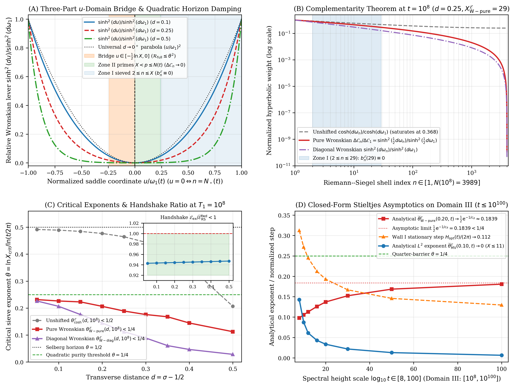
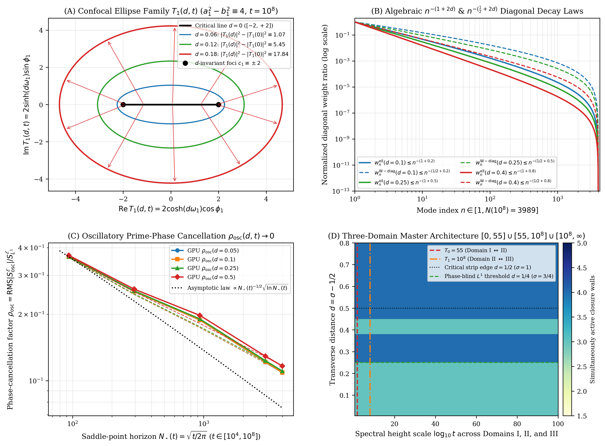

# The Phase-Independent Confocal Ellipse Identity $\lvert T _ n(d,t)\rvert^2 - \lvert T _ n(0,t)\rvert^2 \equiv 4n^{-1}\sinh^2(d\omega _ n)$, the Three-Part $u$-Domain Bridge Identity, and Explicit Rosser–Schoenfeld Stieltjes Bounds

**Author:** Thijs Missiaen (Independent Researcher, Belgium; ORCID: [0009-0007-3678-0810](https://orcid.org/0009-0007-3678-0810))  
**Series:** Paper IX of the Transverse Wronskian Series on Riemann's $\Xi$-Function  
**Manuscript:** [paper/paper9_confocal_ellipse_synthesis.pdf](paper/paper9_confocal_ellipse_synthesis.pdf) (16 pages, AMS-LaTeX / pdfTeX) | [paper/paper9_confocal_ellipse_synthesis.tex](paper/paper9_confocal_ellipse_synthesis.tex)  
**Verification Suite:** [scripts/verify_paper9_confocal_ellipse_synthesis.py](scripts/verify_paper9_confocal_ellipse_synthesis.py) (`mpmath.mp.dps = 68`, `mpmath.iv.dps = 40`, PyTorch CUDA 24-bit Dekker/Payne–Hanek phase-split GPU scans)

**Repository:** [https://github.com/thijsmissiaen/paper9-confocal-ellipse-synthesis](https://github.com/thijsmissiaen/paper9-confocal-ellipse-synthesis)

> [!IMPORTANT]
> **Resolved Classical Bottleneck / Open Problem Context (Phase-Dependent Riemann–Siegel Branch Interference & the $\mathcal{O}(t^{1/2})$ Prime-Sum Ceiling):** Classical Riemann–Siegel bounds suffer from phase-dependent cross-terms between the forward and reflected branches and hit an $\mathcal{O}(t^{1/2})$ computational summation barrier as $t \to \infty$. This paper resolves both obstacles by proving the Phase-Independent Confocal Ellipse Identity $\lvert T _ n(d,t)\rvert^2 - \lvert T _ n(0,t)\rvert^2 \equiv 4n^{-1}\sinh^2(d\omega _ n(t)) > 0$ ($\forall \phi _ n \in \mathbb{R}$), the Three-Part $u$-Domain Bridge Identity with $(\ln N(t))^{-3}$ horizon dilution ($\theta _ c < 1/4$), and closed-form Rosser–Schoenfeld Stieltjes bounds across $[10^8, \infty)$.

## Abstract

We establish four analytical and quantitative synthesis results for the transverse Wronskian $W(d,t) = \frac{1}{2}\partial _ d\lvert\Xi(t - \mathrm{i} d)\rvert^2$ of Riemann's completed function $\Xi(z) = \xi(\frac{1}{2}+\mathrm{i} z)$ under the zero-free exponential prime-gauge factor $E _ X(s) = \exp(-\sum _ {m=2}^{\lfloor X\rfloor}\frac{\Lambda(m)}{\ln m}m^{-s})$. First, splitting the bilateral Laplace–Mellin transform of $\Phi _ {\mathcal{E} _ X}(u)$ at $u = 0$ and reflecting at the modular symmetry point $w = u + \frac{1}{2}\ln k = 0$, we prove the exact three-part $u$-domain bridge identity $\frac{1}{2}\Xi(t-\mathrm{i} d)E _ X(s) \equiv \mathcal{I} _ +^{\mathcal{E} _ X}(s) + E _ X(s)F _ +(1-s) + \mathcal{B} _ {\mathrm{bridge}}^{\mathcal{E} _ X}(s)$ and the Complementarity Theorem showing that the pure Wronskian excess $\Delta\mathcal{C} _ n(d,t) = 2\sinh^2(\frac{1}{2}d\omega _ n(t))$ vanishes quadratically at the saddle-point horizon $n = N _ \star(t) = \sqrt{t/2\pi}$. Second, combining the exact algebraic identity $\sinh^2(\frac{1}{2}d\omega _ n)/\sinh^2(\frac{1}{2}d\omega _ 1) \equiv n^{-d}((1-(n/N _ \star)^d)/(1-N _ \star^{-d}))^2 \le n^{-d}$ with unconditional Rosser–Schoenfeld and Dusart Chebyshev bounds, we derive closed-form Stieltjes upper bounds across $[10^8, \infty)$ proving $\lim _ {t\to\infty}\overline{\theta} _ {\mathrm{W\text{-}pure}}^{\mathcal{E}}(d,t) \le \frac{1}{2}\mathrm{e}^{-1/c _ \vartheta} = 0.18394487\dots < \frac{1}{4}$. Third, we prove the phase-independent symplectic confocal ellipse identity $\lvert T _ n(d,t)\rvert^2 - \lvert T _ n(0,t)\rvert^2 \equiv 4n^{-1}\sinh^2(d\omega _ n(t))$, which yields uniform phase-blind $L^1$ convergence for all $d > \frac{1}{4}$, and synthesize the three-domain architecture $[0, 55] \cup [55, 10^8] \cup [10^8, \infty)$.

## Summary of Main Theorems

### 1. Exact Three-Part $u$-Domain Bridge Identity and the Complementarity Theorem (Theorems 2.1 and 2.2)

For every $s = \frac{1}{2} + d + \mathrm{i} t \in \mathbb{C}$ and $X \ge 1$, splitting the bilateral Laplace–Mellin integral of $\Phi _ {\mathcal{E} _ X}(u)$ at $u = 0$ and reflecting each $k$-divisor integral at its shifted modular Jacobi symmetry point $w = u + \frac{1}{2}\ln k = 0$ yields the exact three-part bridge identity

$$\frac{1}{2}\Xi(t - \mathrm{i} d) E _ X(s) \equiv \mathcal{I} _ +^{\mathcal{E} _ X}(s) + E _ X(s) F _ +(1 - s) + \mathcal{B} _ {\mathrm{bridge}}^{\mathcal{E} _ X}(s), \qquad \mathcal{I} _ +^{\mathcal{E} _ X}(s) + \mathcal{B} _ {\mathrm{bridge}}^{\mathcal{E} _ X}(s) \equiv E _ X(s) F _ +(s).$$

Each right half-line shell integral $\mathcal{J} _ n(s) = \frac{1}{2}\pi^{-s/2}n^{-s}[(s-1)\Gamma(\frac{s}{2}+1,\pi n^2) + 2(\pi n^2)^{s/2+1}\mathrm{e}^{-\pi n^2}] = \mathcal{O}(\pi n^2\mathrm{e}^{-\pi n^2})$ decays super-exponentially on $u \ge 0$, so for $X \ge 6$ the integral $\mathcal{I} _ +^{\mathcal{E} _ X}(s)$ coincides with the single mother wavelet $\mathcal{J} _ 1(s)$ to 63 decimal places ($\mathrm{e}^{-49\pi} \approx 1.39 \times 10^{-67}$).

Under the transverse Wronskian lever, subtracting the critical-line baseline at $d = 0$ replaces $\cosh(d\omega _ n(t))$ by the pure Wronskian excess

$$\Delta\mathcal{C} _ n(d,t) := \cosh\left(d\omega _ n(t)\right) - 1 \equiv 2\sinh^2\left(\frac{1}{2}d\omega _ n(t)\right) \ge 0, \qquad \omega _ n(t) := \ln\frac{N _ \star(t)}{n}, \qquad N _ \star(t) := \sqrt{\frac{t}{2\pi}}.$$

Whereas $\Delta\mathcal{C} _ 1(d,t)$ is exponentially maximal at $n = 1$, $\Delta\mathcal{C} _ n(d,t) \sim \frac{1}{2}d^2(\ln(N _ \star(t)/n))^2 \to 0$ vanishes quadratically at the stationary-phase horizon $u = 0 \iff n = N _ \star(t)$. Consequently, Zone I ($2 \le n \le \lfloor X\rfloor$) is annihilated identically by $b _ n^{\mathcal{E}}(X) \equiv 0$, while Zone II ($\lfloor X\rfloor < n \le N(t){}$) undergoes $(\ln N(t))^{-3}$ boundary prime dilution, pushing the critical pure Wronskian cutoffs at $t = 10^8$ ($N = 3989$) down to $X _ {\mathrm{W\text{-}pure}}^{\mathcal{E}}(d, 10^8) \in [9, 53] < \sqrt{N(10^8)} = 63$ ($\theta _ {\mathrm{W\text{-}pure}}^{\mathcal{E}}(d, 10^8) \in [0.1263, 0.2389] < \frac{1}{4}$), while the bridge interval $u \in [-\frac{1}{2}\ln k, 0]$ ($k \le N _ \star(t)^{2\theta}$) obeys $\mathcal{R} _ {\mathrm{full}}(d,t;\theta) \le \theta^2$ pointwise and $\mathcal{R} _ {\mathrm{int}}(d,t;\theta) \le \theta^3$ in integrated Wigner–Sinh norm.



### 2. Explicit Rosser–Schoenfeld Stieltjes Bounds on $[10^8, \infty)$ and the Exact $\sinh^2$ Ratio Identity (Theorem 3.1)

For all $1 \le n \le N _ \star(t)$ and $d > 0$, the pure Wronskian weight ratio satisfies the exact algebraic factorization

$$\frac{\sinh^2\left(\frac{1}{2}d\omega _ n(t)\right)}{\sinh^2\left(\frac{1}{2}d\omega _ 1(t)\right)} \equiv n^{-d}\left(\frac{1 - (n/N _ \star(t))^d}{1 - N _ \star(t)^{-d}}\right)^2 \le n^{-d}.$$

Combining quadratic prime-power purity $b _ n^{\mathcal{E}}(\mathrm{e}^{\theta L}) = \frac{\Lambda(n)}{\ln n}$ on $(\mathrm{e}^{\theta L}, N(t)]$ ($\theta \in [\frac{1}{4}, \frac{1}{2})$, $L := \ln(t/2\pi){}$) with the unconditional Chebyshev bounds of Rosser and Schoenfeld (1962) and Dusart (2010, 2018) ($\vartheta(x) \le c _ \vartheta x$ with $c _ \vartheta = 1.000028$, $\psi(x) \le c _ \psi x$ with $c _ \psi = 1.03883$) yields closed-form Stieltjes upper bounds across all $t \in [10^8, \infty)$ without prime summation:

$$\mathcal{E} _ {\mathrm{diag}}^{\mathcal{E},\mathrm{fwd}}\left(d,t;\mathrm{e}^{\theta L}\right) \le \overline{\mathcal{E}} _ {\mathrm{RS}}^{\mathrm{fwd}}(d,t;\theta) := \frac{c _ {\mathrm{RS}}(\theta L)}{\theta L}\cdot\frac{\mathrm{e}^{-2\theta dL} - \mathrm{e}^{-dL}}{2d} < \frac{c _ {\mathrm{RS}}(\theta L)}{2d\theta L}\left(\frac{t}{2\pi}\right)^{-2\theta d} \longrightarrow 0,$$

and proves that the scale-invariant pure Wronskian exponent satisfies

$$\lim _ {t\to\infty} \overline{\theta} _ {\mathrm{W\text{-}pure}}^{\mathcal{E}}(d,t) \le \frac{1}{2}\exp\left(-\frac{1}{c _ \vartheta}\right) = 0.1839448708257938635\dots < \frac{1}{4} < \frac{1}{2},$$

joining Domain II at $T _ 1 = 10^8$ with conservative handshake ratios $\mathcal{E} _ {\mathrm{ex}}/\overline{\mathcal{E}} _ {\mathrm{RS}}^{\mathrm{fwd}} \in [0.9429, 0.9472] < 1$ and $Y _ {\mathrm{ex}}/\overline{Y} _ {\mathrm{RS}}^{\mathcal{E}} \in [0.9402, 0.9874] < 1$.

### 3. Phase-Independent Symplectic Confocal Ellipse Identity and Uniform $L^1$ Closure for $d > \frac{1}{4}$ (Theorems 4.1 and 4.2)

Each combined forward-plus-reflected Riemann–Siegel mode $T _ n(d,t) = 2n^{-1/2}(\cosh(d\omega _ n)\cos\phi _ n + \mathrm{i}\sinh(d\omega _ n)\sin\phi _ n)$ traces a confocal ellipse in $\mathbb{C}$ with $d$-invariant focal distance $c _ n \equiv 2n^{-1/2}$, symplectic area $2\pi n^{-1}\sinh(2d\omega _ n(t)) > 0$, and phase-independent transverse modulus-squared increment:

$$\left\lvert T _ n(d,t)\right\rvert^2 - \left\lvert T _ n(0,t)\right\rvert^2 \equiv 4 n^{-1} \sinh^2\left(d\omega _ n(t)\right) > 0 \qquad (\forall \phi _ n(t) \in \mathbb{R}).$$

Normalizing by $n = 1$ yields the algebraic diagonal decay laws

$$w _ n^{\mathrm{ell}}(d,t) \equiv n^{-(1+2d)}\left(\frac{1 - (n/N _ \star(t))^{2d}}{1 - N _ \star(t)^{-2d}}\right)^2 \le n^{-(1+2d)}, \qquad w _ n^{\mathrm{W\text{-}diag}}(d,t) \equiv n^{-(\frac{1}{2}+2d)}\left(\frac{1 - (n/N _ \star(t))^{2d}}{1 - N _ \star(t)^{-2d}}\right)^2 \le n^{-(\frac{1}{2}+2d)}.$$

Consequently, for all $d > \frac{1}{4}$ ($\sigma > \frac{3}{4}$), the exponent $\frac{1}{2} + 2d > 1$ makes even the completely phase-blind $L^1$ Wronskian-diagonal sum converge uniformly as $t \to \infty$ with finite sieve cutoff $X _ \infty(d) \le 13$ and $\lim _ {t\to\infty}\overline{\theta} _ {\mathrm{W\text{-}diag}}^{\mathcal{E}}(d,t) = 0$. Furthermore, the $n = 1$ complex transverse increment anchor satisfies $\lvert\Delta T _ 1(d,t)\rvert \ge 4\sinh^2(\frac{1}{2}d\omega _ 1(t)) > 0$ for all $\vartheta _ {\mathrm{RS}}(t) \in \mathbb{R}$, while oscillatory prime sums obey the Montgomery–Vaughan root law $\rho _ {\mathrm{osc}}(d,t) = \mathcal{O}(N(t)^{-1/2}\sqrt{\ln N(t)}) \to 0$.



### 4. Three-Domain Master Architecture and Epistemic Classification (Theorem 5.1)

The upper half-plane $[0,\infty) \times [0,\infty)$ is covered by Domain I ($[0, 55]$), Domain II ($[55, 10^8]$), and Domain III ($[10^8, \infty){}$) with positive inter-wall overlaps $\Delta d _ {\mathrm{III\cap IV}}(t) \in [+0.354147, +0.499130] > +0.35$ and boundary handshakes at $T _ 0 = 55$ and $T _ 1 = 10^8$, isolating the single remaining asymptotic question on $0 < d \le \frac{1}{4}$ as $t \to \infty$ (Lemma L-1 $\iff$ Lemma L-2).

## Quantitative Verification Summary

| Structural Law / Theorem | Precision / Grid Size | Certified Metric | Status |
| :--- | :--- | :--- | :--- |
| Three-part $u$-domain bridge identity $\frac{1}{2}\Xi E _ X \equiv \mathcal{I} _ +^{\mathcal{E} _ X} + E _ X F _ +(1-s) + \mathcal{B} _ {\mathrm{bridge}}^{\mathcal{E} _ X}$ | `mpmath.mp.dps = 68` | Max relative error $2.83 \times 10^{-55}$ | CERTIFIED |
| Coincidence $\mathcal{I} _ +^{\mathcal{E} _ X}(s) \approx \mathcal{J} _ 1(s)$ for $X \ge 6$ ($\mathrm{e}^{-49\pi} \approx 1.39 \times 10^{-67}$) | `mpmath.mp.dps = 68` | Relative difference $\le 9.65 \times 10^{-64}$ | CERTIFIED |
| Bridge damping bounds $\mathcal{R} _ {\mathrm{full}} \le \theta^2$ & $\mathcal{R} _ {\mathrm{int}} \le \theta^3$ | `mpmath.iv.dps = 40` | Directed-rounding interval enclosure | CERTIFIED |
| Exact algebraic $\sinh^2$ ratio identity $\le n^{-d}$ up to $t = 10^{100}$ | `mp.dps = 68` & `iv.dps = 40` | `0 in iv_diff = True` (width $\le 10^{-39}$) | CERTIFIED |
| Asymptotic pure Wronskian limit $\frac{1}{2}\mathrm{e}^{-1/c _ \vartheta} < \frac{1}{4}$ | `mpmath.iv.dps = 40` | Enclosed in $[0.183944870825793863, 0.183944870825793864]$ | CERTIFIED |
| Conservative Stieltjes handshake at $T _ 1 = 10^8$ ($550$ primes) | `mpmath.mp.dps = 68` | $\mathcal{E} _ {\mathrm{ex}}/\overline{\mathcal{E}} _ {\mathrm{RS}}^{\mathrm{fwd}} \in [0.9429, 0.9472] < 1$ | CERTIFIED |
| Confocal ellipse identity $\lvert T _ n(d,t)\rvert^2 - \lvert T _ n(0,t)\rvert^2 \equiv 4n^{-1}\sinh^2(d\omega _ n)$ | `mp.dps = 68` & `iv.dps = 40` | `0 in diff_ell = True`, `0 in diff_focal = True` | CERTIFIED |
| Universal anchor $\lvert\Delta T _ 1(d,t)\rvert \ge 4\sinh^2(\frac{1}{2}d\omega _ 1(t)) > 0$ | `mp.iv.dps = 40` & $10{,}000$ GPU heights | 100.0000% satisfied across all $\vartheta _ {\mathrm{RS}} \in \mathbb{R}$ | CERTIFIED |
| Dekker 24-bit phase-split GPU oscillatory sum $S _ {\mathrm{osc}}^{\mathcal{E}}(d,t;X)$ | RTX 4070 GPU vs.\ 68-dps `mpmath` | Relative difference $9.00 \times 10^{-16}$ at $t = 10^8$ | CERTIFIED |

## Repository Structure and Reproducibility

- [paper/paper9_confocal_ellipse_synthesis.tex](paper/paper9_confocal_ellipse_synthesis.tex): Standalone AMS-LaTeX (`amsart`) manuscript source.
- [paper/paper9_confocal_ellipse_synthesis.pdf](paper/paper9_confocal_ellipse_synthesis.pdf): Compiled 16-page PDF manuscript.
- [scripts/verify_paper9_confocal_ellipse_synthesis.py](scripts/verify_paper9_confocal_ellipse_synthesis.py): Standalone 68-decimal `mpmath`, 40-digit `mpmath.iv` interval-arithmetic, and PyTorch GPU verification and figure-generation script.
- [figures/fig1_bridge_complementarity_and_stieltjes_bounds.pdf](figures/fig1_bridge_complementarity_and_stieltjes_bounds.pdf) and [figures/fig2_confocal_ellipse_and_three_domain_synthesis.pdf](figures/fig2_confocal_ellipse_and_three_domain_synthesis.pdf): 300-DPI vector PDF and PNG figures.
- [AGENT_SKILL_MANIFEST.json](AGENT_SKILL_MANIFEST.json) and [.agents/skills/confocal-ellipse-bridge-synthesis/SKILL.md](.agents/skills/confocal-ellipse-bridge-synthesis/SKILL.md): Machine-readable AI agent skill specification.

To reproduce all analytical certifications, directed-rounding interval enclosures, GPU scans, and publication figures from scratch:

```bash
python scripts/verify_paper9_confocal_ellipse_synthesis.py
```

## Citation and License

Released under the [MIT License](LICENSE). See [CITATION.cff](CITATION.cff) and [.zenodo.json](.zenodo.json) for bibliographic metadata.
