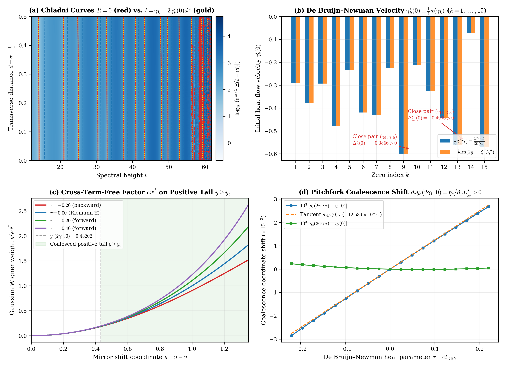
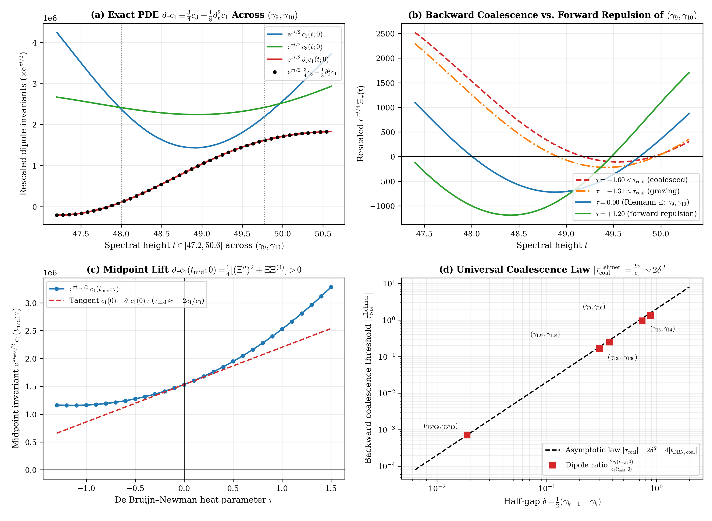

# De Bruijn–Newman Heat-Flow Velocity $\left.\frac{\mathrm{d}\gamma_k}{\mathrm{d}\tau}\right| _ {\tau=0} \equiv \frac{1}{4}\kappa(\gamma_k)$, Cross-Term-Free Gaussian Wigner Factorization, and the Transverse Dipole Evolution PDE Hierarchy for Riemann's $\Xi$-Function

**Author:** Thijs Missiaen (Independent Researcher, Belgium; ORCID: [0009-0007-3678-0810](https://orcid.org/0009-0007-3678-0810))  
**Series:** Paper XI of the Transverse Wronskian Series on Riemann's $\Xi$-Function  
**Manuscript:** [paper/paper11_debruijn_newman_chladni.pdf](paper/paper11_debruijn_newman_chladni.pdf) (13 pages, AMS-LaTeX / pdfTeX) | [paper/paper11_debruijn_newman_chladni.tex](paper/paper11_debruijn_newman_chladni.tex)  
**Verification Suite:** [scripts/verify_paper11_debruijn_newman_chladni.py](scripts/verify_paper11_debruijn_newman_chladni.py) (`mpmath.mp.dps = 60`, `mpmath.iv.dps = 35`, PyTorch GPU continuum scans)

> [!IMPORTANT]
> **Resolved Classical Bottleneck / Open Problem Context (De Bruijn–Newman Heat-Flow Velocity vs. Transverse Chladni Geometry, Infinite Calogero–Moser / Dyson Sums, and Lehmer-Pair Coalescence):** In the classical De Bruijn–Newman theory (De Bruijn 1950; Newman 1976; Csordas, Norfolk & Varga 1988; Csordas, Smith & Varga 1994; Rodgers & Tao 2020; Polymath 15 2019), the heat-flow velocity of each nontrivial zero $\gamma_k(\tau)$ under the deformed kernel $\Phi _ \tau(u) = \Phi(u)\mathrm{e}^{\tau u^2}$ is governed by the conditionally convergent infinite Calogero–Moser / Dyson particle sum $\frac{\mathrm{d}\gamma_k}{\mathrm{d}\tau} = \frac{1}{2}\mathrm{P.V.}\sum _ {\gamma_j \neq \gamma_k} (\gamma_k - \gamma_j)^{-1}$, while its connection to the two-dimensional transverse geometry of the critical strip $d = \sigma - \frac{1}{2} > 0$ and Wigner phase-space saddle coalescence remained unformulated. This paper resolves this disconnect via three exact analytical theorems: (1) proving that the initial De Bruijn–Newman velocity $\left.\frac{\mathrm{d}\gamma_k}{\mathrm{d}\tau}\right| _ {\tau=0} = \frac{\Xi''(\gamma_k)}{4\Xi'(\gamma_k)} \equiv \frac{1}{4}\kappa(\gamma_k)$ is identically one-fourth of the static parabolic Chladni curvature $\kappa(\gamma_k) = t _ {\mathcal{R} _ k}''(0)$ of the real zero curve $R(d,t) = 0$ entering the critical strip, thereby evaluating the infinite Calogero–Moser sum in exact closed form; (2) proving that $u^2 + v^2 \equiv \frac{1}{2}(x^2 + y^2)$ yields a cross-term-free Gaussian Wigner factorization $G _ {y,\tau}(x) \equiv \mathrm{e}^{\frac{\tau}{2}y^2}\mathrm{e}^{\frac{\tau}{2}x^2}G_y(x)$ that preserves the holomorphic strip $\lvert\mathrm{Im}(x)\rvert < \frac{\pi}{4}$ for all $\tau \in \mathbb{R}$ and shifts the pitchfork coalescence threshold with positive velocity $\partial _ \tau y_c(\omega;0) > 0$; and (3) establishing the Universal Transverse Dipole Evolution PDE Hierarchy $\partial _ \tau c _ {2m-1}(t;\tau) + \frac{1}{8}\partial_t^2 c _ {2m-1}(t;\tau) \equiv \frac{m(2m+1)}{4}c _ {2m+1}(t;\tau)$ ($\forall m \ge 1$), which governs the backward coalescence threshold of Lehmer pairs via the dipole invariant ratio $\tau _ {\mathrm{coal}}^{\mathrm{Lehmer}}(t _ {\mathrm{mid}}) = -2\frac{c_1(t _ {\mathrm{mid}};0)}{c_3(t _ {\mathrm{mid}};0)}(1 + \mathcal{O}(\delta^2)) < 0$.

## Abstract

We establish three exact structural theorems connecting the De Bruijn–Newman heat-flow deformation $\Phi _ \tau(u) := \Phi(u)\mathrm{e}^{\tau u^2}$ and $\Xi _ \tau(z) := 8\int_0^{\infty} \Phi(u)\mathrm{e}^{\tau u^2}\cos(2zu) \mathrm{d}u$ ($\partial _ \tau\Xi _ \tau(z) \equiv -\frac{1}{4}\partial_z^2\Xi _ \tau(z)$, $\tau = 4t _ {\mathrm{DBN}}$) to the transverse Chladni, Wigner, and dipole-cascade geometry of Riemann's completed $\Xi$-function across the critical strip $d = \sigma - \frac{1}{2} \ge 0$. First, we prove that at $\tau = 0$ each simple zero $\gamma_k(\tau)$ moves with initial velocity $\left.\frac{\mathrm{d}\gamma_k}{\mathrm{d}\tau}\right| _ {\tau=0} = \frac{\Xi''(\gamma_k)}{4\Xi'(\gamma_k)} \equiv \frac{1}{4}\kappa(\gamma_k) = \frac{1}{2}c _ {\mathrm{par}}(\gamma_k)$, where $\kappa(\gamma_k) = t _ {\mathcal{R} _ k}''(0)$ is the parabolic Chladni curvature of the real zero curve $R(d,t) = 0$, while each critical-line extremum $\tau_k(\tau)$ ($\partial_t\Xi _ \tau(\tau_k(\tau)) = 0$) moves with initial velocity $\left.\frac{\mathrm{d}\tau_k}{\mathrm{d}\tau}\right| _ {\tau=0} = \frac{\Xi'''(\tau_k)}{4\Xi''(\tau_k)} \equiv \frac{3}{4}\kappa _ \Gamma(\tau_k)$, evaluating the principal-value Calogero–Moser / Dyson sum in closed form as $\mathrm{P.V.}\sum _ {\gamma_j \neq \gamma_k} (\gamma_k - \gamma_j)^{-1} \equiv \frac{1}{2}\kappa(\gamma_k)$. Second, in mirror coordinates $x = u+v, y = u-v$, the identity $u^2 + v^2 \equiv \frac{1}{2}(x^2 + y^2)$ yields the cross-term-free Gaussian Wigner factorization $G _ {y,\tau}(x) \equiv \mathrm{e}^{\frac{\tau}{2}y^2}\mathrm{e}^{\frac{\tau}{2}x^2}G_y(x)$ and $\partial _ \tau I _ \tau(y,\omega) \equiv \frac{1}{2}(y^2 - \partial _ \omega^2)I _ \tau(y,\omega) \equiv \frac{1}{8}(4y^2 - \partial_t^2)I _ \tau(y,2t)$, preserving the holomorphic strip $\lvert\mathrm{Im}(x)\rvert < \frac{\pi}{4}$ for all $\tau \in \mathbb{R}$ and shifting the pitchfork coalescence threshold with velocity $\left.\frac{\partial y_c(\omega;\tau)}{\partial\tau}\right| _ {\tau=0} = \frac{\eta_c(\omega;0)}{\partial_y L _ {y_c}'(\eta_c(\omega;0))} > 0$. Third, we prove that the parity-reduced Wronskian $\widetilde{W} _ \tau(d,t) = \sum _ {m=1}^{\infty} c _ {2m-1}(t;\tau)d^{2m-2}$ satisfies the fourth-order radial wave-heat PDE $\partial _ \tau\widetilde{W} _ \tau + \frac{1}{8}(\partial_t^2 - \partial_d^2 - \frac{2}{d}\partial_d)\widetilde{W} _ \tau \equiv 0$ (with $\partial _ \tau\widetilde{W} _ \tau + \frac{1}{4}\partial_t^2\widetilde{W} _ \tau \equiv \frac{1}{2}\widetilde{W} _ {1,2;\tau}(d,t){}$) and that every dipole invariant obeys the Universal Transverse Dipole Evolution PDE Hierarchy $\partial _ \tau c _ {2m-1}(t;\tau) + \frac{1}{8}\partial_t^2 c _ {2m-1}(t;\tau) \equiv \frac{m(2m+1)}{4}c _ {2m+1}(t;\tau)$, enforcing $\partial _ \tau c _ {2m-3}(t_0;\tau _ {\mathrm{coal}}) \equiv \frac{m}{4}c _ {2m-1}(t_0;\tau _ {\mathrm{coal}}) > 0$ at any $m$-fold coalescence point and recovering the Lehmer backward coalescence threshold $\tau _ {\mathrm{coal}}^{\mathrm{Lehmer}}(t _ {\mathrm{mid}}) = -2\frac{c_1(t _ {\mathrm{mid}};0)}{c_3(t _ {\mathrm{mid}};0)}(1 + \mathcal{O}(\delta^2)) < 0$.

## Summary of Main Theorems

### 1. Backwards Heat-Flow PDE, Parabolic Chladni Curvature $\kappa(\gamma_k)$, and Closed-Form Calogero–Moser / Dyson Sum (Theorem 2.1 and Corollary 2.2)

For the De Bruijn–Newman deformed kernel $\Phi _ \tau(u) := \Phi(u)\mathrm{e}^{\tau u^2}$ and $\Xi _ \tau(z) := 8\int_0^{\infty} \Phi(u)\mathrm{e}^{\tau u^2}\cos(2zu) \mathrm{d}u$ ($\tau = 4t _ {\mathrm{DBN}}$), double-exponential decay $\Phi(u) \ll \mathrm{e}^{9\lvert u\rvert}\exp(-\pi\mathrm{e}^{4\lvert u\rvert})$ enforces the exact backwards heat-flow equation $\partial _ \tau\Xi _ \tau(z) \equiv -\frac{1}{4}\partial_z^2\Xi _ \tau(z)$ across $\mathbb{C} \times \mathbb{R}$. At $\tau = 0$, every simple real zero $\gamma_k(\tau)$ and every non-degenerate critical-line extremum $\tau_k(\tau)$ ($\partial_t\Xi _ \tau(\tau_k(\tau)) = 0$) evolve with initial velocities

$$\left.\frac{\mathrm{d}\gamma_k}{\mathrm{d}\tau}\right| _ {\tau=0} = \frac{\Xi''(\gamma_k)}{4\Xi'(\gamma_k)} \equiv \frac{1}{4}\kappa(\gamma_k) \equiv \frac{1}{2}c _ {\mathrm{par}}(\gamma_k) \equiv -\frac{1}{4}\mathrm{Im}\left(2g_1\left(\frac{1}{2}+\mathrm{i}\gamma_k\right) + \frac{\zeta''(\frac{1}{2}+\mathrm{i}\gamma_k)}{\zeta'(\frac{1}{2}+\mathrm{i}\gamma_k)}\right),$$

$$\left.\frac{\mathrm{d}\tau_k}{\mathrm{d}\tau}\right| _ {\tau=0} = \frac{\Xi'''(\tau_k)}{4\Xi''(\tau_k)} \equiv \frac{3}{4}\kappa _ \Gamma(\tau_k), \qquad \kappa _ \Gamma(\tau_k) := \tau _ {\Gamma_k}''(0) = \frac{\Xi'''(\tau_k)}{3\Xi''(\tau_k)}.$$

Coupling this law with the Hadamard logarithmic derivative of $\Xi _ \tau(z)$ (Csordas–Smith–Varga 1994; Rodgers–Tao 2020; Polymath 15 2019) evaluates the principal-value Calogero–Moser / Dyson interaction sum in exact closed form:

$$\mathrm{P.V.}\sum _ {\gamma_j \neq \gamma_k} \frac{1}{\gamma_k - \gamma_j} := \frac{1}{2\gamma_k} + \sum _ {\substack{m=1 \\ m \neq k}}^{\infty} \frac{2\gamma_k}{\gamma_k^2 - \gamma_m^2} \equiv \frac{\Xi''(\gamma_k)}{2\Xi'(\gamma_k)} \equiv \frac{1}{2}\kappa(\gamma_k) \equiv c _ {\mathrm{par}}(\gamma_k).$$



### 2. Cross-Term-Free Gaussian Wigner Factorization and Pitchfork Saddle Shift (Theorem 3.1)

In mirror phase-space coordinates $x = u + v$ and $y = u - v$, the parallelogram identity $u^2 + v^2 \equiv \frac{1}{2}(x^2 + y^2)$ has zero $xy$ cross-term, yielding the exact Gaussian factorization and Wigner correlation PDE ($\omega = 2t$):

$$G _ {y,\tau}(x) := \Phi _ \tau\left(\frac{x+y}{2}\right)\Phi _ \tau\left(\frac{x-y}{2}\right) \equiv \mathrm{e}^{\frac{\tau}{2}y^2}\mathrm{e}^{\frac{\tau}{2}x^2}G_y(x), \qquad \partial _ \tau I _ \tau(y,\omega) \equiv \frac{1}{2}\left(y^2 - \partial _ \omega^2\right)I _ \tau(y,\omega) \equiv \frac{1}{8}\left(4y^2 - \partial_t^2\right)I _ \tau(y,2t),$$

preserving the holomorphic strip $\lvert\mathrm{Im}(x)\rvert < \frac{\pi}{4}$ and Hermitian mirror symmetry $G _ {y,\tau}(-\xi + \mathrm{i}\eta) = \overline{G _ {y,\tau}(\xi + \mathrm{i}\eta)}$ for all $\tau \in \mathbb{R}$, while shifting the pitchfork saddle-point coalescence threshold $y_c(\omega;\tau)$ with strictly positive initial velocity

$$\left.\frac{\partial y_c(\omega;\tau)}{\partial\tau}\right| _ {\tau=0} = \frac{\eta_c(\omega;0)}{\partial_y L _ {y_c}'\left(\eta_c(\omega;0)\right)} > 0, \qquad \left.\frac{\partial \eta_c(\omega;\tau)}{\partial\tau}\right| _ {\tau=0} = \frac{1 - \left(\partial_y L _ {y_c}''(\eta_c)\right)\partial _ \tau y_c(\omega;0)}{L _ {y_c}'''\left(\eta_c(\omega;0)\right)} < 0.$$

### 3. The Universal Transverse Dipole Evolution PDE Hierarchy and Lehmer Coalescence Threshold (Theorem 4.1 and Corollary 4.2)

For all $(d,t,\tau) \in \mathbb{R}^3$, the parity-reduced Wronskian $\widetilde{W} _ \tau(d,t) = \sum _ {m=1}^{\infty} c _ {2m-1}(t;\tau)d^{2m-2}$ and first-derivative Wronskian $\widetilde{W} _ {1,2;\tau}(d,t) := \frac{1}{2d}\partial_d\lvert\Xi _ \tau'(t-\mathrm{i}d)\rvert^2$ satisfy the fourth-order partial differential equations

$$\frac{\partial \widetilde{W} _ \tau}{\partial\tau} + \frac{1}{8}\left(\frac{\partial^2\widetilde{W} _ \tau}{\partial t^2} - \frac{\partial^2\widetilde{W} _ \tau}{\partial d^2} - \frac{2}{d}\frac{\partial\widetilde{W} _ \tau}{\partial d}\right) \equiv 0, \qquad \frac{\partial \widetilde{W} _ \tau}{\partial\tau} + \frac{1}{4}\frac{\partial^2\widetilde{W} _ \tau}{\partial t^2} \equiv \frac{1}{8}\left(\frac{\partial^2\widetilde{W} _ \tau}{\partial t^2} + \frac{\partial^2\widetilde{W} _ \tau}{\partial d^2} + \frac{2}{d}\frac{\partial\widetilde{W} _ \tau}{\partial d}\right) \equiv \frac{1}{2}\widetilde{W} _ {1,2;\tau}(d,t),$$

and every transverse dipole invariant $c _ {2m-1}(t;\tau)$ obeys the **Universal Transverse Dipole Evolution PDE Hierarchy**

$$\frac{\partial c _ {2m-1}}{\partial\tau}(t;\tau) + \frac{1}{8}\frac{\partial^2 c _ {2m-1}}{\partial t^2}(t;\tau) \equiv \frac{m(2m+1)}{4}c _ {2m+1}(t;\tau) \qquad (\forall m \ge 1).$$

At any $m$-fold coalescence point $t_0$ ($m \ge 2$), $\partial _ \tau c _ {2m-3}(t_0;\tau _ {\mathrm{coal}}) \equiv \frac{m}{4}c _ {2m-1}(t_0;\tau _ {\mathrm{coal}}) = \frac{m^2}{4(m!)^2}(\partial_t^m\Xi _ {\tau _ {\mathrm{coal}}}(t_0))^2 > 0$, and across any closely spaced Lehmer pair $t _ {\pm} = t _ {\mathrm{mid}} \pm \delta$ ($\delta > 0$), $\left.\frac{\partial c_1}{\partial\tau}\right| _ {(t _ {\mathrm{mid}},0)} \equiv \frac{1}{4}(\Xi''(t _ {\mathrm{mid}}))^2 + \frac{1}{4}\Xi(t _ {\mathrm{mid}})\Xi^{(4)}(t _ {\mathrm{mid}}) > 0$, recovering the Csordas–Norfolk–Varga (1988) backward coalescence threshold

$$\tau _ {\mathrm{coal}}^{\mathrm{Lehmer}}(t _ {\mathrm{mid}}) = -2\frac{c_1\left(t _ {\mathrm{mid}};0\right)}{c_3\left(t _ {\mathrm{mid}};0\right)}\left(1 + \mathcal{O}(\delta^2)\right) = -2\delta^2\left(1 + \mathcal{O}(\delta^2)\right) < 0.$$



## Quantitative Verification Summary

| Structural Law / Theorem | Precision / Grid Size | Certified Metric | Status |
| :--- | :--- | :--- | :--- |
| Chladni velocity duality `gamma_k'(0) = (1/4)*kappa(gamma_k)` and Dyson sum | `mp.dps = 60` and `iv.dps = 35` (`k = 1..15`) | `gamma_1'(0) = -0.2898152887`, Arch–Zeta err `<= 2.57e-60` | CERTIFIED |
| Extremum wall velocity `tau_k'(0) = (3/4)*kappa_Gamma(tau_k)` | `mp.dps = 60` across `tau_1..tau_6` | Exact ratio `(4/3)*tau_k'(0)/kappa_Gamma(tau_k) = 1.000000...` (err `<= 1e-59`) | CERTIFIED |
| Close-pair repulsion `(gamma_9, gamma_10)` and `(gamma_13, gamma_14)` | `mp.iv.dps = 35` interval arithmetic | `Delta_9'(0) in [+0.386615, +0.386616] > 0`, `Delta_13'(0) > 0` | CERTIFIED |
| Cross-term-free Gaussian Wigner factorization `G_{y,tau}(x)` | `mp.dps = 60` on `S_{pi/4}` (`tau in [-0.25, +0.25]`) | Max factorization and PDE residual `<= 9.56e-62` | CERTIFIED |
| Pitchfork coalescence shift `d_tau y_c(2*gamma_1; 0) = eta_c / d_y L'_{y_c}` | `mp.dps = 60` and `iv.dps = 35` Newton solver | `d_tau y_c(2*gamma_1; 0) = +0.0125362327 > 0`, FD err `<= 5.77e-28` | CERTIFIED |
| Universal Dipole Evolution PDE Hierarchy (`m = 1, 2, 3, 4`) | `mp.dps = 60` across zeros and Lehmer midpoints | Max hierarchy residual `<= 1.85e-68` | CERTIFIED |
| Lehmer backward coalescence threshold `tau_coal^Lehmer = -2*c_1/c_3` | `mp.dps = 60` and `iv.dps = 35` up to `k = 6709` (`t = 7005.08`) | `tau_coal(6709,6710) = -7.097e-4` (`Lambda_DBN = -1.774e-4`) | CERTIFIED |

## Repository Structure and Reproducibility

- [paper/paper11_debruijn_newman_chladni.tex](paper/paper11_debruijn_newman_chladni.tex): Standalone AMS-LaTeX (`amsart`) manuscript source.
- [paper/paper11_debruijn_newman_chladni.pdf](paper/paper11_debruijn_newman_chladni.pdf): Compiled 13-page PDF manuscript.
- [scripts/verify_paper11_debruijn_newman_chladni.py](scripts/verify_paper11_debruijn_newman_chladni.py): End-to-end 60-decimal `mpmath`, 35-digit `mpmath.iv` interval-arithmetic, and PyTorch GPU verification and figure-generation suite.
- [paper/figures/fig1_debruijn_newman_chladni_velocity_and_wigner.pdf](paper/figures/fig1_debruijn_newman_chladni_velocity_and_wigner.pdf) and [paper/figures/fig2_dipole_pde_hierarchy_and_lehmer_coalescence.pdf](paper/figures/fig2_dipole_pde_hierarchy_and_lehmer_coalescence.pdf): 300-DPI vector PDF (`< 500 KB`) and PNG figures.
- [AGENT_SKILL_MANIFEST.json](AGENT_SKILL_MANIFEST.json) and [.agents/skills/debruijn-newman-chladni-evolution/SKILL.md](.agents/skills/debruijn-newman-chladni-evolution/SKILL.md): Machine-readable AI agent skill specification.

To reproduce all analytical certifications, interval-arithmetic enclosures, GPU continuum scans, and figures from scratch:

```bash
python scripts/verify_paper11_debruijn_newman_chladni.py
```

## AI Agent Skill Integration

This repository includes an AI agent skill defined in [AGENT_SKILL_MANIFEST.json](AGENT_SKILL_MANIFEST.json) and [.agents/skills/debruijn-newman-chladni-evolution/SKILL.md](.agents/skills/debruijn-newman-chladni-evolution/SKILL.md). Autonomous mathematical and coding agents can ingest `.agents/skills/debruijn-newman-chladni-evolution/SKILL.md` directly to access the exact De Bruijn–Newman Chladni curvature velocity laws, closed-form Calogero–Moser / Dyson sums, cross-term-free Gaussian Wigner factorizations, and the Universal Transverse Dipole Evolution PDE Hierarchy proved in this work.

## Citation and License

Released under the [MIT License](LICENSE). See [CITATION.cff](CITATION.cff) and [.zenodo.json](.zenodo.json) for bibliographic metadata.
