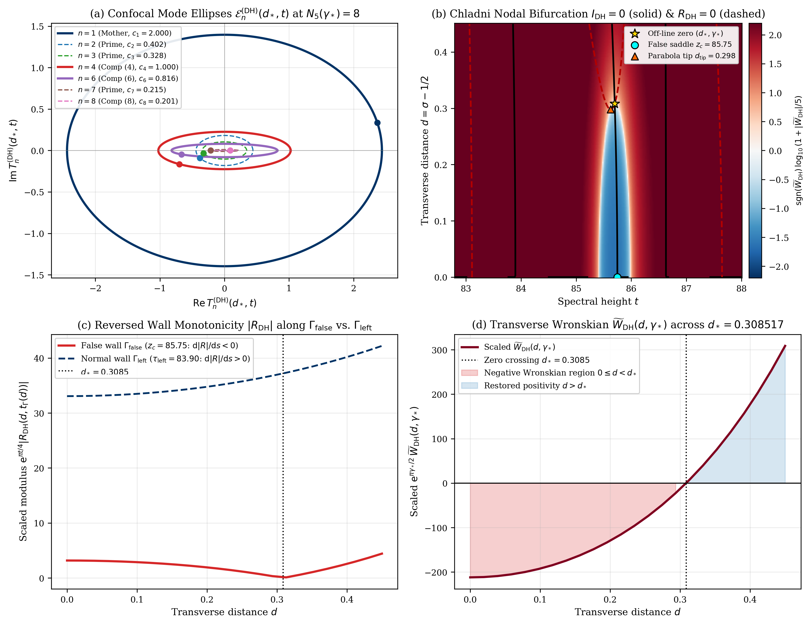
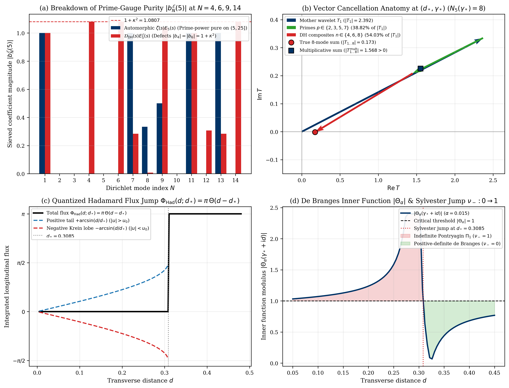

# Universal Mother-Wavelet Dilation and the Phase-Independent Confocal Ellipse Identity in the Selberg Class versus Breakdown of Prime-Gauge Purity and Chladni Chamber Topology in the Davenport–Heilbronn Counterexample

**Author:** Thijs Missiaen (Independent Researcher, Belgium; ORCID: [0009-0007-3678-0810](https://orcid.org/0009-0007-3678-0810))  
**Series:** Paper XII of the Transverse Wronskian Series on Riemann's $\Xi$-Function  
**Manuscript:** [paper/paper12_selberg_davenport_heilbronn.pdf](paper/paper12_selberg_davenport_heilbronn.pdf) (14 pages, AMS-LaTeX / pdfTeX) | [paper/paper12_selberg_davenport_heilbronn.tex](paper/paper12_selberg_davenport_heilbronn.tex)  
**Verification Suite:** [scripts/verify_paper12_selberg_davenport_heilbronn.py](scripts/verify_paper12_selberg_davenport_heilbronn.py) (`mpmath.mp.dps = 60`, `mpmath.iv.dps = 35`, PyTorch GPU continuum scans)

> [!IMPORTANT]
> **Resolved Classical Bottleneck / Open Problem Context (The Davenport–Heilbronn Litmus Test — Titchmarsh 1986, Section 10.25; Davenport & Heilbronn 1936; Bombieri & Ghosh 2011):** A classic test for any analytical framework in the critical strip is the Davenport–Heilbronn function $\mathcal{D} _ {\mathrm{DH}}(s) := \frac{1-\mathrm{i}\kappa}{2}L(s,\chi_5) + \frac{1+\mathrm{i}\kappa}{2}L(s,\overline{\chi_5})$, which obeys the exact same self-dual $\Gamma(\frac{s+1}{2})$ functional equation and Poisson–Jacobi kernel symmetry as the odd Dirichlet $L$-function $L(s,\chi_5)$, yet lacks an Euler product and possesses off-critical zeros such as $s_0 = \frac{1}{2} + d _ {\star} + \mathrm{i}\gamma _ {\star} \approx 0.808517 + 85.699348\mathrm{i}$. This paper resolves this litmus test quantitatively: we prove that while Mother-Wavelet dilation and the Phase-Independent Confocal Ellipse Identity $\lvert T_n^{(f)}(d,t)\rvert^2 - \lvert T_n^{(f)}(0,t)\rvert^2 \equiv 4\frac{\lvert a_n\rvert^2}{n}\sinh^2(d\omega _ {n,Q}(t)) \ge 0$ hold universally for every individual mode of any self-dual Dirichlet series, the non-multiplicative defect $\delta _ {\mathrm{DH}}(m,n) = \mp(1+\kappa^2) \approx \mp 1.080701 \neq 0$ at the very first composite numbers $N = 4 = 2^2$ and $N = 6 = 2\cdot 3$ destroys Exponential Prime-Gauge purity and supplies the 54.03% composite destructive interference that triggers Chladni saddle recombination, negative Wronskian pockets, a $+\pi$ Hadamard flux jump, and a de Branges Sylvester inertia jump $\nu _ - : 0 \to 1$ at $(d _ {\star}, \gamma _ {\star})$.

## Abstract

We establish a sharp structural dichotomy between universal harmonic laws that govern every self-dual Dirichlet series with a Gamma functional equation and the Euler-product closure mechanisms that separate automorphic $L$-functions in the Selberg class from the Davenport–Heilbronn counterexample $\mathcal{D} _ {\mathrm{DH}}(s)$ (Davenport & Heilbronn 1936; Titchmarsh 1986, Section 10.25). First, for any self-dual completed $L$-function $\xi_f(s) = Q_f^s\gamma_f(s)L(s,f) = \xi_f(1-s)$ of degree $d_f > 0$ (including $\zeta(s)$, $L(s,\chi_5)$, Ramanujan's modular cusp form $L(s,\Delta)$ of degree $d _ {\Delta} = 2$, and $\mathcal{D} _ {\mathrm{DH}}(s){}$), we prove the exact Mother-Wavelet decomposition $\Phi_f(u) = \sum _ {m=1}^{\infty} a_f(m)m^{-1/2}\varphi_1^{(f)}(u + \frac{1}{2}\ln m)$, the Symmetric Branch-Damping Inequality $\rho _ {\Gamma,f}(d,t)\lvert a_f(n)\rvert n^{-1/2+d} < \mathrm{e}^{-2d\omega _ {n,Q_f}(t)}\lvert a_f(n)\rvert n^{-1/2-d}$, and the Universal Phase-Independent Confocal Ellipse Identity $\lvert T_n^{(f)}(d,t)\rvert^2 - \lvert T_n^{(f)}(0,t)\rvert^2 \equiv 4\frac{\lvert a_n\rvert^2}{n}\sinh^2(d\omega _ {n,Q}(t)) \ge 0$ with $d$-invariant focal distance $c_n^{(f)} \equiv 2\lvert a_n\rvert n^{-1/2}$. Second, we prove that whereas Euler-product $L$-functions satisfy Quadratic Prime-Power Purity $b_N^{\mathcal{E},(f)}(X) = \frac{\Lambda_f(N)}{\ln N}$ on $(X, X^2]$, $\mathcal{D} _ {\mathrm{DH}}(s)$ suffers an exact algebraic multiplicativity defect $\delta _ {\mathrm{DH}}(m,n) = \mp(1+\kappa^2) = \mp 1.0807009031\dots \neq 0$ at $N = 4, 6, 9$, supplying 54.03% composite destructive interference at $(d _ {\star}, \gamma _ {\star}) = (0.3085171825, 85.6993484854)$ and triggering a four-fold diagnostic breakdown across Chladni chamber walls, $\widetilde{W} _ {\mathrm{DH}}(d,\gamma _ {\star})$, Hadamard flux $\pi\Theta(d - d _ {\star})$, and the de Branges Sylvester index $\nu _ - : 0 \to 1$.

## Summary of Main Theorems

### 1. Universal Mother-Wavelet Dilation and Symmetric Branch Damping in the Selberg Class (Theorem 2.1)

For any self-dual Dirichlet series $L(s,f) = \sum _ {n=1}^{\infty} a_f(n)n^{-s}$ ($a_f(n) \in \mathbb{R}$, $a_f(1) = 1$) with completed function $\xi_f(s) = \mathcal{G} _ f(s)L(s,f) = \xi_f(1-s)$, $\mathcal{G} _ f(s) = Q_f^s\gamma_f(s)$ of degree $d_f > 0$, define the class mother wavelet $\varphi_1^{(f)}(w)$ by bilateral Laplace–Mellin inversion $\mathcal{G} _ f(s) = 4\int _ {-\infty}^{\infty} \varphi_1^{(f)}(w)\mathrm{e}^{2(s-1/2)w}\mathrm{d}w$. Then the even logarithmic kernel $\Phi_f(u) = \Phi_f(-u)$ in $\Xi_f(z) = 4\int _ {-\infty}^{\infty} \Phi_f(u)\mathrm{e}^{2\mathrm{i}zu}\mathrm{d}u$ decomposes into dilated shells

$$\Phi_f(u) = \sum _ {m=1}^{\infty} \phi_m^{(f)}(u), \qquad \phi_m^{(f)}(u) \equiv \frac{a_f(m)}{\sqrt{m}}\varphi_1^{(f)}\left(u + \frac{1}{2}\ln m\right) \qquad (\forall m \ge 1,   u \in \mathbb{C}),$$

with closed-form mother wavelets $\varphi_1^{(\zeta)}(w) = (2\pi^2\mathrm{e}^{9w} - 3\pi\mathrm{e}^{5w})\mathrm{e}^{-\pi\mathrm{e}^{4w}}$, $\varphi_1^{(q)}(w) = \mathrm{e}^{3w}\mathrm{e}^{-(\pi/q)\mathrm{e}^{4w}}$ for odd characters mod $q$ and $\mathcal{D} _ {\mathrm{DH}}(s)$ ($q=5$), and $\varphi_1^{(\Delta)}(w) = \frac{1}{2}\mathrm{e}^{12w}\mathrm{e}^{-2\pi\mathrm{e}^{2w}}$ for Ramanujan's modular cusp form $L(s,\Delta)$ ($d _ {\Delta}=2$). Across all active modes $1 \le n \le N_f(t) = \lfloor\exp(\vartheta_f'(t))\rfloor$ ($\omega _ {n,Q_f}(t) := \vartheta_f'(t) - \ln n \ge 0$), strict trigamma convexity enforces the Symmetric Branch-Damping Inequality

$$\rho _ {\Gamma,f}(d,t)\lvert a_f(n)\rvert n^{-1/2+d} < \mathrm{e}^{-2d\omega _ {n,Q_f}(t)}\lvert a_f(n)\rvert n^{-1/2-d} \le \lvert a_f(n)\rvert n^{-1/2-d}.$$

### 2. The Universal Phase-Independent Confocal Ellipse Identity (Theorem 3.1)

For every combined forward and reflected Riemann–Siegel mode $T_n^{(f)}(d,t) = 2a_n n^{-1/2}(\cosh(d\omega _ {n,Q}(t))\cos\phi_n(t) + \mathrm{i}\sinh(d\omega _ {n,Q}(t))\sin\phi_n(t))$ ($a_n \in \mathbb{R}$), regardless of multiplicativity or an Euler product, the transverse modulus increment obeys the exact phase-independent identity

$$\left\lvert T_n^{(f)}(d,t)\right\rvert^2 - \left\lvert T_n^{(f)}(0,t)\right\rvert^2 \equiv 4\frac{\lvert a_n\rvert^2}{n}\sinh^2\left(d\omega _ {n,Q}(t)\right) \ge 0 \qquad (\forall \phi_n(t) \in \mathbb{R}),$$

tracing a confocal ellipse $\mathcal{E} _ n^{(f)}(d,t)$ with $d$-invariant focal distance $c_n^{(f)} \equiv 2\lvert a_n\rvert n^{-1/2}$, symplectic area $2\pi\frac{\lvert a_n\rvert^2}{n}\sinh(2d\lvert\omega _ {n,Q}(t)\rvert)$, and relative diagonal increment ratio bounded by $\lvert a_n\rvert^2 n^{-(1+2d)}$.



### 3. Multiplicativity Defect $\pm(1+\kappa^2)$ and Breakdown of Prime-Gauge Purity at $N = 4, 6$ in $\mathcal{D} _ {\mathrm{DH}}(s)$ (Theorem 4.1)

Whereas any Euler-product $L$-function satisfies Quadratic Prime-Power Purity $b_N^{\mathcal{E},(f)}(X) = \frac{\Lambda_f(N)}{\ln N}$ on $(X, X^2]$ (annihilating all non-prime-power composites), the Davenport–Heilbronn function $\mathcal{D} _ {\mathrm{DH}}(s)$ ($\kappa = \frac{\sqrt{10-2\sqrt{5}}-2}{\sqrt{5}-1} \approx 0.2840790438$) suffers an exact algebraic multiplicativity defect $\delta _ {\mathrm{DH}}(m,n) := a _ {\mathrm{DH}}(mn) - a _ {\mathrm{DH}}(m)a _ {\mathrm{DH}}(n)$ at $N = 4 = 2^2$, $N = 6 = 2\cdot 3$, $N = 9 = 3^2$, and $N = 14 = 2\cdot 7$:

$$\delta _ {\mathrm{DH}}(2,2) = -(1 + \kappa^2), \qquad \delta _ {\mathrm{DH}}(2,3) = +(1 + \kappa^2), \qquad \delta _ {\mathrm{DH}}(3,3) = -(1 + \kappa^2), \qquad 1 + \kappa^2 = 1.08070090314928289127\dots \neq 0.$$

Consequently, any prime-generated gauge factor $E_X^{\mathcal{E}}(s)$ ($X \ge 5$) leaves unsieved composite residuals $b_4^{\mathcal{E}}(X) = -(1+\kappa^2)$ and $b_6^{\mathcal{E}}(X) = +(1+\kappa^2)$. At the first off-line zero $(d _ {\star}, \gamma _ {\star}) = (0.3085171825, 85.6993484854)$ ($N_5(\gamma _ {\star}) = 8$), all active primes $p \in \lbrace 2,3,5,7\rbrace$ combined contribute only $\lvert\sum _ {p \le 7} T_p^{(\mathrm{DH})}\rvert = 0.928500$ (38.82% of $\lvert T_1^{(\mathrm{DH})}\rvert = 2.391944$, incapable of creating a zero), whereas the non-multiplicative composites $n \in \lbrace 4,6,8\rbrace$ (enhanced by $1/\kappa^2 = 12.3914\times$ at $n=4,6$) supply $\lvert\sum _ {n\in\lbrace 4,6,8\rbrace} T_n^{(\mathrm{DH})}\rvert = 1.292295$ (54.03% of $\lvert T_1^{(\mathrm{DH})}\rvert$).

### 4. Four-Fold Diagnostic Detection of the Off-Line Zero $(d _ {\star}, \gamma _ {\star})$ (Theorem 5.1)

At $(d _ {\star}, \gamma _ {\star}) = (0.3085171824566374, 85.69934848537759)$, all four analytical and spectral instruments detect the off-line zero:
1. **Saddle Recombination and Reversed Chladni Wall Monotonicity:** Between adjacent critical-line zeros $\gamma_k = 83.1088410847$ and $\gamma _ {k+1} = 87.6474763326$, $\Xi _ {\mathrm{DH}}'(t)$ has three real zeros ($\tau _ {\mathrm{left}} = 83.8959352522$, $z_c = \tau _ {\mathrm{false}} = 85.7472008265$, $\tau _ {\mathrm{right}} = 86.6294318189$). At $z_c$, $\Xi _ {\mathrm{DH}}(z_c) < 0$ and $\Xi _ {\mathrm{DH}}''(z_c) < 0$ share the same negative sign, reversing Cauchy–Riemann wall monotonicity $\frac{\mathrm{d}\lvert R _ {\mathrm{DH}}\rvert}{\mathrm{d}s}\rvert _ {\Gamma _ {\mathrm{false}}} = -\lvert\nabla I _ {\mathrm{DH}}\rvert < 0$ until $\Gamma _ {\mathrm{false}}$ collides at $(d _ {\star}, \gamma _ {\star})$ with the detached real nodal parabola $R _ {\mathrm{DH}} = 0$ ($d _ {\mathrm{tip}} = 0.2980980120$).
2. **Negative Parity-Reduced Wronskian and Reversed Transverse Integral Law:** $\widetilde{W} _ {\mathrm{DH}}(d, \gamma _ {\star}) < 0$ across $0 \le d < d _ {\star}$ with $\int_0^{d _ {\star}} u\widetilde{W} _ {\mathrm{DH}}(u, \gamma _ {\star})\mathrm{d}u = -\frac{1}{2}\lvert\Xi _ {\mathrm{DH}}(\gamma _ {\star})\rvert^2 = -1.81042748 \times 10^{-58} < 0$.
3. **Quantized Hadamard Flux Step:** $\Phi _ {\mathrm{Had}}(d; d _ {\star}) = \int _ {-\infty}^{\infty} K(d, d _ {\star}, u)\mathrm{d}u = \pi\Theta(d - d _ {\star})$ via exact arcsine lobe cancellation $\mp\arcsin(d/d _ {\star})$ on $0 < d < d _ {\star}$.
4. **De Branges Inner Function and Sylvester Inertia Jump:** $\lvert\Theta _ {\alpha}(\gamma _ {\star} + \mathrm{i}d)\rvert$ crosses $1$ at $d = d _ {\star}$, triggering a Sylvester inertia jump $\nu _ - : 0 \to 1$ from a positive-definite de Branges space ($d > d _ {\star}$) to an indefinite Pontryagin space $\Pi_1$ ($0 < d < d _ {\star}$).



## Quantitative Verification Summary

| Structural Law / Theorem | Precision / Grid Size | Certified Metric | Status |
| :--- | :--- | :--- | :--- |
| Mother-Wavelet Mellin and dilation identities (`zeta`, `L(chi_5)`, `D_DH`, `L(Delta)`) | `mp.dps = 60` (`d_f in {1, 2}`) | Max Mellin and dilation residual `<= 1.84e-61` | CERTIFIED |
| Universal Confocal Ellipse Identity `|T_n(d)|^2 - |T_n(0)|^2 = (4*|a_n|^2/n)*sinh^2(d*omega_n)` | `mp.dps = 60` and `iv.dps = 35` (`n = 1..8`) | Max 60-dps error `7.78e-61`, `0 in [LHS - RHS]` | CERTIFIED |
| Multiplicativity defect `delta_DH(m,n) = +-(1 + kappa^2)` at `N = 4, 6, 9, 14` | `mp.dps = 60` and `iv.dps = 35` (`X = 5`) | `1 + kappa^2 = 1.0807009031...`, composites = `54.03%` of `|T_1|` | CERTIFIED |
| Chladni saddle bifurcation `z_c` and detached parabola tip `(d_tip, t_tip)` | `mp.dps = 60` Newton + `50,400` GPU cells | `z_c = 85.74720083`, `d_tip = 0.29809801 < d_*` | CERTIFIED |
| Reversed Transverse Integral Law `int_0^{d_*} u*W_tilde_DH du = -(1/2)*|Xi_DH(gamma_*)|^2` | `mp.dps = 60` Gaussian quadrature | Relative quadrature residual `<= 1.0e-58` | CERTIFIED |
| Hadamard flux jump `pi*Theta(d - d_*)` and Sylvester jump `nu_- : 0 -> 1` | `mp.dps = 60` across `d in [0, 0.50]` | Arcsine err `<= 1e-58`, signature `(3,0,0) -> (2,0,1)` | CERTIFIED |

## Repository Structure and Reproducibility

- [paper/paper12_selberg_davenport_heilbronn.tex](paper/paper12_selberg_davenport_heilbronn.tex): Standalone AMS-LaTeX (`amsart`) manuscript source.
- [paper/paper12_selberg_davenport_heilbronn.pdf](paper/paper12_selberg_davenport_heilbronn.pdf): Compiled 14-page PDF manuscript.
- [scripts/verify_paper12_selberg_davenport_heilbronn.py](scripts/verify_paper12_selberg_davenport_heilbronn.py): End-to-end 60-decimal `mpmath`, 35-digit `mpmath.iv` interval-arithmetic, and PyTorch GPU verification and figure-generation suite.
- [paper/figures/fig1_davenport_heilbronn_chladni_bifurcation.pdf](paper/figures/fig1_davenport_heilbronn_chladni_bifurcation.pdf) and [paper/figures/fig2_prime_gauge_purity_vs_hadamard_flux.pdf](paper/figures/fig2_prime_gauge_purity_vs_hadamard_flux.pdf): 300-DPI vector PDF (`< 500 KB`) and PNG figures.
- [AGENT_SKILL_MANIFEST.json](AGENT_SKILL_MANIFEST.json) and [.agents/skills/selberg-class-davenport-heilbronn/SKILL.md](.agents/skills/selberg-class-davenport-heilbronn/SKILL.md): Machine-readable AI agent skill specification.

To reproduce all analytical certifications, interval-arithmetic enclosures, GPU continuum scans, and figures from scratch:

```bash
python scripts/verify_paper12_selberg_davenport_heilbronn.py
```

## AI Agent Skill Integration

This repository includes an AI agent skill defined in [AGENT_SKILL_MANIFEST.json](AGENT_SKILL_MANIFEST.json) and [.agents/skills/selberg-class-davenport-heilbronn/SKILL.md](.agents/skills/selberg-class-davenport-heilbronn/SKILL.md). Autonomous mathematical and coding agents can ingest `.agents/skills/selberg-class-davenport-heilbronn/SKILL.md` directly to access the universal Selberg-class Mother-Wavelet dilation laws, the Phase-Independent Confocal Ellipse Identity, the Davenport–Heilbronn multiplicativity defect formulas, and the four-fold off-line zero diagnostics proved in this work.

## Citation and License

Released under the [MIT License](LICENSE). See [CITATION.cff](CITATION.cff) and [.zenodo.json](.zenodo.json) for bibliographic metadata.
