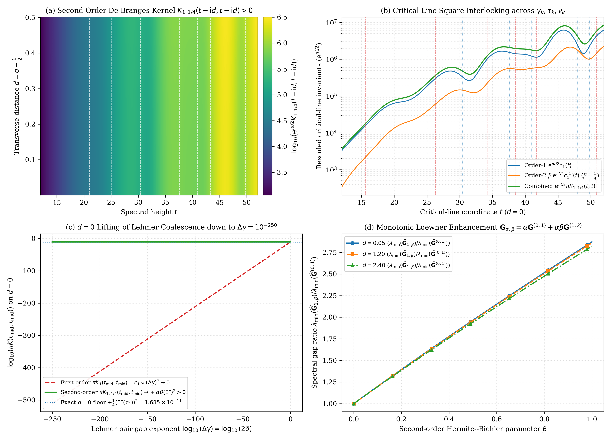
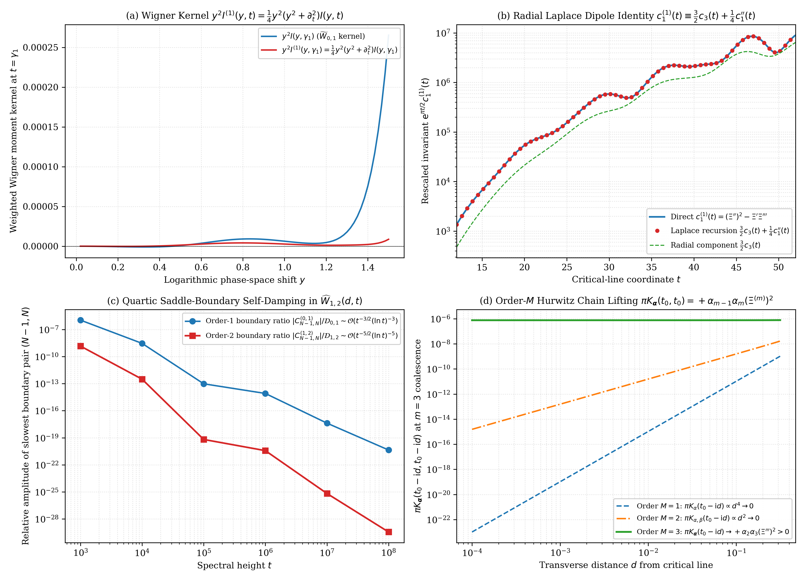

# Second-Order Hermite–Biehler De Branges Kernels, the Derivative-Wronskian Splitting $K _ {\alpha,\beta} \equiv \frac{\alpha}{\pi}\widetilde{W} _ {0,1} + \frac{\alpha\beta}{\pi}\widetilde{W} _ {1,2}$, and $d = 0$ Lifting of the Lehmer Near-Coalescence Degeneracy for Riemann's $\Xi$-Function

**Author:** Thijs Missiaen (Independent Researcher, Belgium; [thijs.missiaen@gmail.com](mailto:thijs.missiaen@gmail.com); ORCID: [0009-0007-3678-0810](https://orcid.org/0009-0007-3678-0810))  
**Series:** Paper XIII of the Transverse Wronskian Series on Riemann's $\Xi$-Function  
**Manuscript:** [paper/paper13_second_order_debranges.pdf](paper/paper13_second_order_debranges.pdf) (15 pages, AMS-LaTeX / pdfTeX) | [paper/paper13_second_order_debranges.tex](paper/paper13_second_order_debranges.tex)  
**Verification Suite:** [scripts/verify_paper13_second_order_debranges.py](scripts/verify_paper13_second_order_debranges.py) (`mpmath.mp.dps = 60`, `mp.workdps(550)`, `mpmath.iv.dps = 35`, vectorized continuum scans)

> [!IMPORTANT]
> **Resolved Classical Bottleneck / Open Problem Context (Lagarias–Ki–Suzuki Second-Order Hermite–Biehler Kernels & Critical-Line $d = 0$ Lehmer Near-Coalescence Degeneracy):** For the first-order de Branges structure function $E _ \alpha(z) = \Xi(z) - \mathrm{i}\alpha\Xi'(z)$ ($\beta = 0$, Paper IV), the reproducing kernel $K _ \alpha(t-\mathrm{i} d, t-\mathrm{i} d) \equiv \frac{\alpha}{\pi}\widetilde{W} _ {0,1}(d,t)$ vanishes on the critical line $d = 0$ at any hypothetical double zero ($\Xi(t_0) = \Xi'(t_0) = 0$) and scales as $\mathcal{O}(\delta^2) \to 0$ at the midpoint $t _ {\mathrm{mid}}$ of a closely spaced Lehmer pair $t _ \pm = t _ {\mathrm{mid}} \pm \delta$ where $\Xi'(t _ {\mathrm{mid}}) = 0$, so strict positivity emerges only transversely at order $d^2$. This paper proves that for the second-order Lagarias–Ki–Suzuki Hermite–Biehler family $E _ {\alpha,\beta}(z) := \Xi(z) - \mathrm{i}\alpha\Xi'(z) - \beta\Xi''(z)$ ($\alpha > 0, \beta > 0$), all three squared moduli ($\lvert\Xi\rvert^2, \alpha^2\lvert\Xi'\rvert^2, \beta^2\lvert\Xi''\rvert^2$) and the $(0,2)$ cross-term $-2\beta\mathrm{Re}(\overline{\Xi}\Xi'') \equiv 0$ cancel identically, yielding the exact splitting $K _ {\alpha,\beta}(t-\mathrm{i} d, t-\mathrm{i} d) \equiv \frac{\alpha}{\pi}\widetilde{W} _ {0,1}(d,t) + \frac{\alpha\beta}{\pi}\widetilde{W} _ {1,2}(d,t)$ and lifting the $d = 0$ Lehmer degeneracy already at order $d^0$ via the strictly positive critical-line floor $\pi K _ {\alpha,\beta}(t _ {\mathrm{mid}}, t _ {\mathrm{mid}}) \equiv -\alpha\Xi(t _ {\mathrm{mid}})\Xi''(t _ {\mathrm{mid}}) + \alpha\beta(\Xi''(t _ {\mathrm{mid}}))^2 \to +\alpha\beta(\Xi''(t_0))^2 > 0$.

## Abstract

We prove that for the second-order Hermite–Biehler structure function $E _ {\alpha,\beta}(z) := \Xi(z) - \mathrm{i}\alpha\Xi'(z) - \beta\Xi''(z)$ ($\alpha > 0, \beta > 0$) studied by Lagarias, Ki, and Suzuki, the de Branges reproducing kernel $K _ {\alpha,\beta}(t-\mathrm{i} d, t-\mathrm{i} d)$ exhibits an exact cancellation of all three quadratic norms ($\lvert\Xi\rvert^2, \alpha^2\lvert\Xi'\rvert^2, \beta^2\lvert\Xi''\rvert^2$) and of the $(0,2)$ cross-term $-2\beta\mathrm{Re}(\overline{\Xi}\Xi'') \equiv 0$, splitting into $K _ {\alpha,\beta}(t-\mathrm{i} d, t-\mathrm{i} d) \equiv \frac{\alpha}{\pi}\widetilde{W} _ {0,1}(d,t) + \frac{\alpha\beta}{\pi}\widetilde{W} _ {1,2}(d,t)$, where $\widetilde{W} _ {1,2}(d,t) = \frac{1}{2d}\partial_d\lvert\Xi'(t-\mathrm{i} d)\rvert^2$ is the parity-reduced derivative Wronskian. Consequently, on the critical line $d \to 0^+$, $\pi K _ {\alpha,\beta}(t,t) \equiv \alpha c_1(t) + \alpha\beta c_1^{(1)}(t)$, so at the midpoint $t _ {\mathrm{mid}}$ of any closely spaced Lehmer pair where $\Xi'(t _ {\mathrm{mid}}) = 0$, $\pi K _ {\alpha,\beta}(t _ {\mathrm{mid}}, t _ {\mathrm{mid}}) \equiv -\alpha\Xi(t _ {\mathrm{mid}})\Xi''(t _ {\mathrm{mid}}) + \alpha\beta(\Xi''(t _ {\mathrm{mid}}))^2 \to +\alpha\beta(\Xi''(t_0))^2 > 0$ remains strictly positive on $d = 0$ itself at order $d^0$. Finally, we prove the radial four-dimensional Laplace coupling $\widetilde{W} _ {1,2} \equiv \frac{1}{4}(\partial_d^2 + \frac{2}{d}\partial_d + \partial_t^2)\widetilde{W} _ {0,1}$, the dipole recursion $c _ {2m-1}^{(1)}(t) \equiv \frac{1}{4}(2m(2m+1)c _ {2m+1}(t) + c _ {2m-1}''(t))$, and the order $M$ Hurwitz coalescence law $\pi K _ {\boldsymbol{\alpha}}(t_0, t_0) = +\alpha _ {m-1}\alpha_m(\Xi^{(m)}(t_0))^2 + \mathcal{O}(\alpha _ {>m}) > 0$.

## Summary of Main Theorems

### 1. The Exact Second-Order De Branges Reproducing Kernel Identity and Cauchy–Pick Splitting (Theorem 2.1 & Proposition 2.2)

For all $\alpha, \beta \in \mathbb{R}$ and every $w = t - \mathrm{i} d \in \mathbb{C}$ with $d \neq 0$, let $E _ {\alpha,\beta}(z) := \Xi(z) - \mathrm{i}\alpha\Xi'(z) - \beta\Xi''(z)$ and $E _ {\alpha,\beta}^{\sharp}(z) := \Xi(z) + \mathrm{i}\alpha\Xi'(z) - \beta\Xi''(z)$. Writing $E _ {\alpha,\beta}(z) = A _ \beta(z) - \mathrm{i}\alpha B(z)$ with $A _ \beta(z) := \Xi(z) - \beta\Xi''(z)$ and $B(z) := \Xi'(z)$, Hermitian polarization cancels $\lvert A _ \beta(w)\rvert^2 + \alpha^2\lvert B(w)\rvert^2 = \lvert\Xi(w)\rvert^2 + \alpha^2\lvert\Xi'(w)\rvert^2 + \beta^2\lvert\Xi''(w)\rvert^2 - 2\beta\mathrm{Re}(\overline{\Xi(w)}\Xi''(w))$ identically, yielding the exact cross-term-free decomposition

$$K _ {\alpha,\beta}(t - \mathrm{i} d, t - \mathrm{i} d) = \frac{\lvert E _ {\alpha,\beta}(t - \mathrm{i} d)\rvert^2 - \lvert E _ {\alpha,\beta}^{\sharp}(t - \mathrm{i} d)\rvert^2}{4\pi d} \equiv \frac{\alpha}{\pi}\widetilde{W} _ {0,1}(d,t) + \frac{\alpha\beta}{\pi}\widetilde{W} _ {1,2}(d,t),$$

where $\widetilde{W} _ {0,1}(d,t) = \frac{1}{2d}\partial_d\lvert\Xi(t-\mathrm{i} d)\rvert^2$ is the primary parity-reduced Wronskian of $\Xi$ and $\widetilde{W} _ {1,2}(d,t) = \frac{1}{2d}\partial_d\lvert\Xi'(t-\mathrm{i} d)\rvert^2 = d^{-1}\mathrm{Im}(\overline{\Xi'(t-\mathrm{i} d)}\Xi''(t-\mathrm{i} d))$ is the parity-reduced Lucas–Jensen derivative Wronskian of $\Xi'$. Moreover, for any finite set of nodes $z_1, \dots, z_M \in \mathbb{C} _ -$, the $M \times M$ off-diagonal Cauchy–Pick Gram matrix splits linearly in the Loewner cone as

$$\mathbf{G} _ {\alpha,\beta}(z_1, \dots, z_M) \equiv \alpha\mathbf{G}^{(0,1)}(z_1, \dots, z_M) + \alpha\beta\mathbf{G}^{(1,2)}(z_1, \dots, z_M)$$

with zero non-adjacent jump terms, making degree $M _ {\mathrm{deg}} = 2$ the unique polynomial order above $M _ {\mathrm{deg}} = 1$ whose reproducing kernel decomposes purely into adjacent transverse Wronskians.



### 2. Lifting the $d = 0$ Lehmer Near-Coalescence Degeneracy at Order $d^0$ and Square Interlocking (Theorem 3.1)

Taking the critical-line limit $d \to 0^+$ yields the exact combination

$$\pi K _ {\alpha,\beta}(t,t) \equiv \alpha\left(\left(\Xi'(t)\right)^2 - \Xi(t)\Xi''(t)\right) + \alpha\beta\left(\left(\Xi''(t)\right)^2 - \Xi'(t)\Xi'''(t)\right) = \alpha c_1(t) + \alpha\beta c_1^{(1)}(t).$$

At the intermediate local extremum $t _ {\mathrm{mid}}$ where $\Xi'(t _ {\mathrm{mid}}) = 0$ between any closely spaced Lehmer pair $t _ \pm = t _ {\mathrm{mid}} \pm \delta$ with $\delta > 0$, the term $-\Xi'(t _ {\mathrm{mid}})\Xi'''(t _ {\mathrm{mid}}) \equiv 0$ vanishes without remainder, leaving the strictly positive pure square $c_1^{(1)}(t _ {\mathrm{mid}}) = (\Xi''(t _ {\mathrm{mid}}))^2 > 0$ at order $d^0$:

$$\pi K _ {\alpha,\beta}(t _ {\mathrm{mid}}, t _ {\mathrm{mid}}) \equiv -\alpha\Xi(t _ {\mathrm{mid}})\Xi''(t _ {\mathrm{mid}}) + \alpha\beta\left(\Xi''(t _ {\mathrm{mid}})\right)^2 \xrightarrow{\delta \to 0} +\alpha\beta\left(\Xi''(t_0)\right)^2 > 0.$$

Globally along $d = 0$, pure squares interlock topologically across simple zeros $\gamma_k$ ($c_1(\gamma_k) = (\Xi'(\gamma_k))^2 > 0$), local extrema $\tau_k$ ($c_1^{(1)}(\tau_k) = (\Xi''(\tau_k))^2 > 0$), and inflection points $\nu_k$ ($c_1(\nu_k) = (\Xi'(\nu_k))^2 > 0$).

### 3. The Radial Laplace–Wigner Identity, Universal Dipole Recursion, and Order $M$ Hurwitz Chains (Theorems 4.1 & 4.2)

By subharmonic commutation $(\partial_d^2 + \partial_t^2)\lvert\Xi\rvert^2 = 4\lvert\Xi'\rvert^2$, the derivative Wronskian $\widetilde{W} _ {1,2}(d,t)$ is coupled to $\widetilde{W} _ {0,1}(d,t)$ by the exact radial four-dimensional Laplace PDE and universal dipole recursion

$$\widetilde{W} _ {1,2}(d,t) \equiv \frac{1}{4}\left(\frac{\partial^2\widetilde{W} _ {0,1}}{\partial d^2} + \frac{2}{d}\frac{\partial\widetilde{W} _ {0,1}}{\partial d} + \frac{\partial^2\widetilde{W} _ {0,1}}{\partial t^2}\right), \qquad c _ {2m-1}^{(1)}(t) \equiv \frac{1}{4}\left(2m(2m+1)c _ {2m+1}(t) + c _ {2m-1}''(t)\right) \qquad (\forall m \ge 1).$$

In Wigner phase space, $\widetilde{W} _ {1,2}(d,t) = \frac{1}{2}\int_0^{\infty} y^2\mathrm{sinc} _ {\mathrm{hyp}}(dy)I^{(1)}(y,t)\mathrm{d}y$ with $I^{(1)}(y,t) = \frac{1}{4}(y^2 + \partial_t^2)I(y,t)$, which enhances the Riemann–Siegel diagonal to $\mathcal{D} _ {1,2}(0,t) \sim \frac{1}{80}(\ln\frac{t}{2\pi})^5$ and applies quartic $\mathcal{O}(N(t)^{-5}) = \mathcal{O}(t^{-5/2})$ self-damping to the slowest boundary pair $(N-1, N)$. More generally, for any degree $M$ real Hurwitz polynomial $P_M(X) = \sum _ {r=0}^M \alpha_r X^r$ ($\alpha_0 = 1, \alpha_r > 0$), $E _ {\boldsymbol{\alpha}}(z) := P_M(-\mathrm{i}\partial_z)\Xi(z)$ satisfies at any multiplicity $m$ critical-line zero $t_0$ ($1 \le m \le M$) the universal $d = 0$ pure-square law

$$\pi K _ {\boldsymbol{\alpha}}(t_0, t_0) = +\alpha _ {m-1}\alpha_m\left(\Xi^{(m)}(t_0)\right)^2 + \mathcal{O}(\alpha _ {>m}) > 0.$$



## Quantitative Verification Summary

| Structural Law / Theorem | Precision / Grid Size | Certified Metric | Status |
| :--- | :--- | :--- | :--- |
| Second-order de Branges splitting `K_{α,β} = (α/π) W̃_{0,1} + (αβ/π) W̃_{1,2}` | `mp.dps = 60` (12 benchmarks) + 6x6 Gram | Max rel. err `1.21e-59`; Gram err `1.07e-60` | CERTIFIED |
| Critical-line square interlocking across `γ_k, τ_k, ν_k` (`1 <= k <= 10`) | `mp.dps = 60` & `iv.dps = 35` (30 critical points) | `c_1(t).a > 0`, `c_1^{(1)}(t).a > 0`, `π K_{1,1/4}(t,t).a > 0` | CERTIFIED |
| `d = 0` Lehmer near-coalescence lifting down to `Δγ = 10^{-250}` | `mp.workdps(550)` at `τ_2 = 22.09797728...` | Floor `+(1/4)(Ξ''(τ_2))^2 = 1.685481e-11`, err `5.0e-501` | CERTIFIED |
| Radial 4D-Laplace PDE & dipole recursion `c_{2m-1}^{(1)} = (1/4)(2m(2m+1)c_{2m+1} + c_{2m-1}'')` | `mp.dps = 60` (`m = 1, 2` across 6 benchmarks) | PDE rel. err `0.0`; recursion err `<= 7.42e-68` | CERTIFIED |
| Order `M` Hurwitz coalescence law `π K_α(t_0,t_0) = +α_{m-1} α_m (Ξ^{(m)})^2` | `mp.dps = 60` (`M = 4`, multiplicities `m = 1, 2, 3, 4`) | Max relative residual `1.52e-61` across odd & even `m` | CERTIFIED |
| Quartic saddle-boundary self-damping of slowest pair `(N-1, N)` | Exact mode evaluation up to `t = 10^8` (`N = 3,989`) | `|C_{N-1,N}^{(1,2)}| / D_{1,2} = 3.5759e-30` at `t = 10^8` | CERTIFIED |

## Repository Structure and Reproducibility

- [paper/paper13_second_order_debranges.tex](paper/paper13_second_order_debranges.tex): Standalone AMS-LaTeX (`amsart`) manuscript source.
- [paper/paper13_second_order_debranges.pdf](paper/paper13_second_order_debranges.pdf): Compiled 15-page PDF manuscript.
- [scripts/verify_paper13_second_order_debranges.py](scripts/verify_paper13_second_order_debranges.py): End-to-end 60-decimal and 550-decimal `mpmath`, 35-digit `mpmath.iv` interval-arithmetic, and vectorized continuum verification and figure-generation suite.
- [paper/figures/fig1_second_order_debranges_and_lehmer_lifting.pdf](paper/figures/fig1_second_order_debranges_and_lehmer_lifting.pdf) and [paper/figures/fig2_laplace_wigner_dipole_and_hurwitz_chains.pdf](paper/figures/fig2_laplace_wigner_dipole_and_hurwitz_chains.pdf): 300-DPI vector PDF (`< 500 KB`) and PNG figures.
- [AGENT_SKILL_MANIFEST.json](AGENT_SKILL_MANIFEST.json) and [.agents/skills/second-order-debranges-lehmer-lifting/SKILL.md](.agents/skills/second-order-debranges-lehmer-lifting/SKILL.md): Machine-readable AI agent skill specification.

To reproduce all analytical certifications, 550-decimal Lehmer deformations, interval-arithmetic enclosures, continuum scans, and figures from scratch:

```bash
python scripts/verify_paper13_second_order_debranges.py
```

## AI Agent Skill Integration

This repository includes an AI agent skill defined in [AGENT_SKILL_MANIFEST.json](AGENT_SKILL_MANIFEST.json) and [.agents/skills/second-order-debranges-lehmer-lifting/SKILL.md](.agents/skills/second-order-debranges-lehmer-lifting/SKILL.md). Autonomous mathematical and coding agents can ingest `.agents/skills/second-order-debranges-lehmer-lifting/SKILL.md` directly to access the exact second-order de Branges reproducing kernel splitting, $d = 0$ Lehmer near-coalescence lifting formulas, radial 4D-Laplace dipole recursions, and order $M$ Hurwitz chain coalescence laws proved in this work.

## Citation and License

Released under the [MIT License](LICENSE). See [CITATION.cff](CITATION.cff) and [.zenodo.json](.zenodo.json) for bibliographic metadata.
