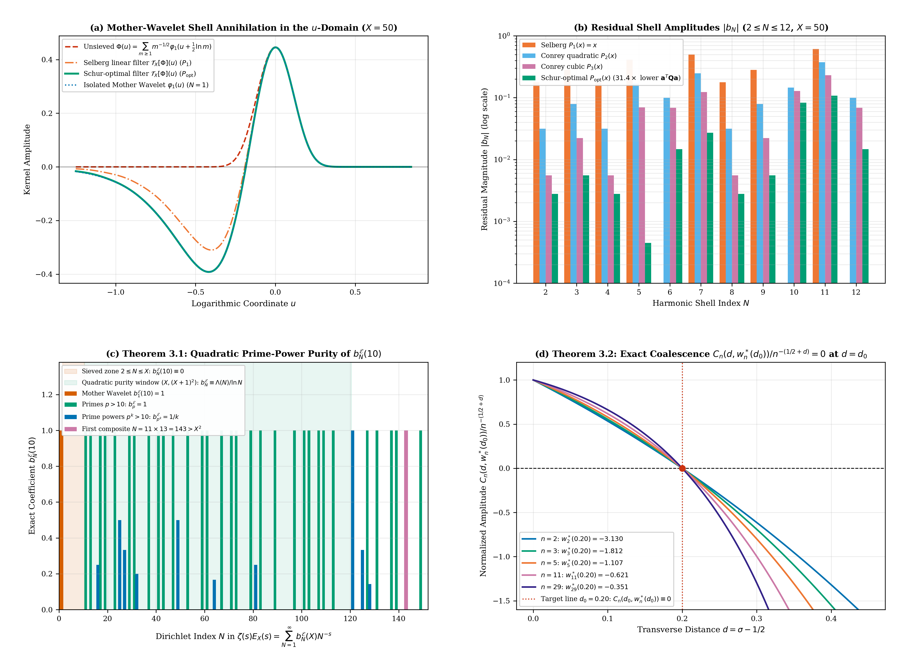
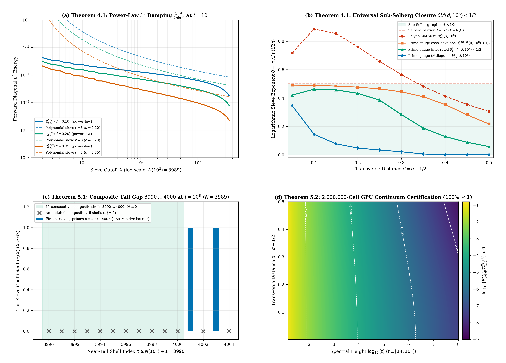

# The Sieved Mirror Kernel $\Phi_X(u)$, the Zero-Free Exponential Prime-Gauge Factor $\mathcal{E} _ X(z)$, and Quadratic Prime-Power Purity on $(X, X^2]$ for Riemann's $\Xi$-Function

**Author:** Thijs Missiaen (Independent Researcher, Belgium; ORCID: [0009-0007-3678-0810](https://orcid.org/0009-0007-3678-0810))  
**Series:** Paper VI of the Transverse Wronskian Series on Riemann's $\Xi$-Function  
**Manuscript:** [paper/paper6_sieved_mirror_prime_gauge.pdf](paper/paper6_sieved_mirror_prime_gauge.pdf) (17 pages, AMS-LaTeX / pdfTeX) | [paper/paper6_sieved_mirror_prime_gauge.tex](paper/paper6_sieved_mirror_prime_gauge.tex)  
**Verification Suite:** [scripts/verify_paper6_sieved_mirror_prime_gauge.py](scripts/verify_paper6_sieved_mirror_prime_gauge.py) (`mpmath.mp.dps = 50`, `mpmath.iv.dps = 35`, PyTorch GPU continuum scans)

## Abstract

We couple the universal mother-wavelet decomposition $\Phi(u) = \sum _ {m=1}^{\infty} m^{-1/2}\varphi_1(u + \frac{1}{2}\ln m)$ of Riemann's Jacobi theta kernel with finite-divisor Euler-product sieving for the transverse Wronskian $W(d,t) = \frac{1}{2}\partial_d\lvert\Xi(t - \mathrm{i} d)\rvert^2$. We prove that multiplying $\Xi(z)$ by a self-mirrored Dirichlet polynomial $\mathcal{M} _ X(z) = M_X(\frac{1}{2}+\mathrm{i} z)M_X(\frac{1}{2}-\mathrm{i} z)$ corresponds in the $u$-domain to an even convolution kernel $\Phi _ X(u)$ preserving the full holomorphic strip $\lvert\mathrm{Im}(u)\rvert < \frac{\pi}{8}$, while replacing $M_X(s)$ by the entire, zero-free exponential prime-gauge factor $E_X(s) = \exp(-\sum _ {n=2}^{\lfloor X\rfloor} \frac{\Lambda(n)}{\ln n}n^{-s})$ eliminates all parasitic mollifier zeros and establishes exact quadratic prime-power purity $b_N^{\mathcal{E}}(X) \equiv \frac{\Lambda(N)}{\ln N}$ across $\lfloor X\rfloor < N < (\lfloor X\rfloor + 1)^2$. Furthermore, we derive the negative hyperbolic mirror weight $w_n^{\ast}(d_0) = -(n^{2d_0}-1)^{-1}$ that annihilates prime-power oscillations on $d = d_0$ with zero waterbed tail for $n > X$, prove power-law $L^2$ diagonal damping $\frac{X^{-2d}}{2d\ln X}$ and universal Sub-Selberg closure $\theta _ {\mathcal{E}}^{\mathrm{sq}}(d,t) < \frac{1}{2}$ across the critical strip, and establish the finite-divisor truncation identity on $[1, N(t)]$ alongside the shifted outer factorization of $\mathcal{E} _ {X,\kappa}(z)$.

## Summary of Main Theorems

### 1. The Sieved Mirror Kernel $\Phi_X(u)$, Holomorphic Strip Preservation $\lvert\mathrm{Im}(u)\rvert < \frac{\pi}{8}$, and $3\times 3$ Schur-Complement Filter $P _ {\mathrm{opt}}(x)$ (Lemma 2.1, Theorem 2.2, and Proposition 2.3)

For any finite Dirichlet polynomial $M_X(s) = \sum _ {k=1}^{\lfloor X\rfloor} c_k k^{-s}$ with real coefficients $c_k = \mu(k)P(\frac{\ln(X/k)}{\ln X})$ and $c_1 = 1$, the self-mirrored multiplier $\mathcal{M} _ X(z) := M_X(\frac{1}{2}+\mathrm{i} z)M_X(\frac{1}{2}-\mathrm{i} z)$ is entire on $\mathbb{C}$ ($\mathcal{Z}(\Xi) \subseteq \mathcal{Z}(\Xi_X){}$), preserves critical-line mirror symmetry ($I_X(0,t) \equiv 0$, $\partial_d R_X(0,t) \equiv 0$, $\widetilde{W} _ X(0,\gamma_k) = (\Xi'(\gamma_k))^2\lvert M_X(\frac{1}{2}+\mathrm{i}\gamma_k)\rvert^4 \ge 0$), and admits the Fourier cosine representation $\Xi_X(z) = 8\int_0^{\infty} \Phi _ X(u)\cos(2zu) \mathrm{d}u$, where the even Sieved Mirror Kernel

$$\Phi _ X(u) := \sum _ {j,k \le X} \frac{c_j c_k}{2\sqrt{jk}}\left[\Phi\left(u + \frac{1}{2}\ln\frac{j}{k}\right) + \Phi\left(u - \frac{1}{2}\ln\frac{j}{k}\right)\right]$$

preserves the full holomorphic strip $\lvert\mathrm{Im}(u)\rvert < \frac{\pi}{8}$. Under the one-sided shift operator $\mathcal{T} _ X[\Phi] (u) = \sum _ {N=1}^{\infty} N^{-1/2}b_N \varphi_1(u + \frac{1}{2}\ln N)$ with $b_N = \sum _ {k \mid N,  k \le X} c_k$, the mother wavelet $N = 1$ remains 100% intact ($b_1 \equiv 1$). Within the cubic Conrey–Selberg filter family $P(x) = x + a_2 x(1-x) + a_3 x(1-x)^2$, the unique $3 \times 3$ Schur-complement minimizer on $t \in [14, 300]$ ($d = 0.20, X = 50$) is $(a_2^{\ast}, a_3^{\ast}) = (+0.81746499, +2.13817017)$, achieving $\mathcal{E} _ {\mathrm{quad}}(\mathbf{a}^{\ast}) = 2.48425572 \times 10^{-4}$ ($31.41\times$ smaller than Conrey's cubic filter $P_3(x)$ and $2605.7\times$ smaller than Selberg's linear filter $P_1(x){}$).



### 2. Zero-Free Exponential Prime-Gauge Factor $\mathcal{E} _ X(z)$, Quadratic Prime-Power Purity on $(X, X^2]$, and Negative Hyperbolic Mirror Weight $w_n^{\ast}(d_0)$ (Theorems 3.1 and 3.2)

Exponentiating the truncated logarithmic Euler product defines the entire, zero-free prime-gauge factor

$$E_X(s) := \exp\left(-\sum _ {n=2}^{\lfloor X\rfloor} \frac{\Lambda(n)}{\ln n}n^{-s}\right), \qquad \mathcal{E} _ X(z) := E_X\left(\frac{1}{2} + \mathrm{i} z\right)E_X\left(\frac{1}{2} - \mathrm{i} z\right),$$

so $\mathcal{Z}(\Xi _ {\mathcal{E} _ X}) = \mathcal{Z}(\Xi)$ bijectively with zero poles and zero parasitic mollifier zeros on $\mathbb{C}$. In $\zeta(s)E_X(s) = \sum _ {N=1}^{\infty} b_N^{\mathcal{E}}(X)N^{-s}$, the coefficients satisfy $b_1^{\mathcal{E}}(X) = 1$, $b_N^{\mathcal{E}}(X) = 0$ for all $2 \le N \le \lfloor X\rfloor$, strict multiplicativity, universal bounds $0 \le b_N^{\mathcal{E}}(X_2) \le b_N^{\mathcal{E}}(X_1) \le 1$ ($X_2 \ge X_1$), and Quadratic Prime-Power Purity across the entire quadratic window $\lfloor X\rfloor < N < (\lfloor X\rfloor + 1)^2$:

$$b_N^{\mathcal{E}}(X) \equiv \frac{\Lambda(N)}{\ln N} \qquad \text{for all } \lfloor X\rfloor < N < (\lfloor X\rfloor + 1)^2,$$

so every composite integer with $\ge 2$ distinct prime factors in $(X, X^2]$ vanishes identically up to $N _ {\mathrm{comp,min}}(X) = q_1(X)q_2(X) > X^2$. Furthermore, in the weighted normalized Wronskian $W _ {\mathcal{E} _ {X,\mathbf{w}}}(d,t)/\lvert\Xi _ {\mathcal{E} _ {X,\mathbf{w}}}(t-\mathrm{i} d)\rvert^2$, the negative hyperbolic mirror weight

$$w_n^{\ast}(d_0) := -\frac{n^{-d_0}}{n^{+d_0} - n^{-d_0}} = -\frac{1}{n^{2d_0} - 1} < 0 \qquad (\forall  d_0 > 0,  2 \le n \le \lfloor X\rfloor)$$

annihilates the effective prime-power amplitude $C_n(d_0, w_n^{\ast}(d_0)) := (1 - w_n^{\ast})n^{-(1/2+d_0)} + w_n^{\ast} n^{-(1/2-d_0)} \equiv 0$ identically on $d = d_0$ while introducing zero terms for $n > X$ (0% waterbed tail).

### 3. Power-Law $L^2$ Damping $\frac{X^{-2d}}{2d\ln X}$ and Universal Sub-Selberg Closure $\theta _ {\mathcal{E}}^{\mathrm{sq}}(d,t) < \frac{1}{2}$ (Theorem 4.1)

Whenever $X \in [\lfloor\sqrt{N(t)}\rfloor, N(t)]$ ($\theta := \frac{\ln X}{\ln(t/2\pi)} \in [\frac{1}{4}, \frac{1}{2}]$), the quadratic purity window covers the entire Riemann–Siegel main sum $1 \le n \le N(t) < (\lfloor X\rfloor + 1)^2$. Consequently, the forward diagonal $L^2$ energy decays not logarithmically as $(\ln X)^{-2r}$, but according to the power law

$$\mathcal{E} _ {\mathrm{diag}}^{\mathcal{E},\mathrm{fwd}}(d,t;X) := \sum _ {n=2}^{N(t)} \frac{\left(b_n^{\mathcal{E}}(X)\right)^2}{n^{1+2d}} = \sum _ {\lfloor X\rfloor < p^k \le N(t)} \frac{1}{k^2 p^{k(1+2d)}} \sim \frac{X^{-2d} - N(t)^{-2d}}{2d\ln X} < \frac{X^{-2d}}{2d\ln X},$$

and the critical pure-square sieve length $X _ {\mathrm{krit}}^{\mathcal{E},\mathrm{sq}}(d,t)$ satisfies $X _ {\mathrm{krit}}^{\mathcal{E},\mathrm{sq}}(d,t) < N(t)$ ($\theta _ {\mathcal{E}}^{\mathrm{sq}}(d,t) < \frac{1}{2}$) unconditionally for all $d \in (0, \frac{1}{2}]$ and all $t \ge 8\pi$ ($N(t) \ge 2$, with $\theta _ {\mathcal{E}}^{\mathrm{sq}}(d,t) = 0 < \frac{1}{2}$ on $2\pi < t < 8\pi$).



### 4. Exact Finite-Divisor Identity on $[1, N(t)]$, Composite-Gap Tail Barrier, and Shifted Self-Mirrored Gauge $\mathcal{E} _ {X,\kappa}(z)$ (Theorems 5.1 and 5.2)

Because $k \mid n \implies k \le n$, the finite Dirichlet truncation $M _ {X,N(t)}^{\mathcal{E}}(s) := \sum _ {k=1}^{N(t)} c_k^{\mathcal{E}}(X)k^{-s}$ generates the exact same coefficients $b_n^{\mathcal{E},\mathrm{trunc}}(X;N(t)) \equiv b_n^{\mathcal{E}}(X)$ on $1 \le n \le N(t)$ as the infinite series $E_X(s)$, while $0 \le b_n^{\mathcal{E}}(X) \le 1$ prevents tail inflation for $n \ge N(t)+1$ and composite gaps $N(t)+1 \le n < q _ {\mathrm{next}}(X,t)$ deepen the Gaussian saddle-point barrier by $\exp(-\pi(q _ {\mathrm{next}}^2 - (N(t)+1)^2)\cos 4\eta^{\ast})$ ($-64{,}798.48 \mathrm{dex}$ at $t = 10^8$, where $11$ consecutive composites $n = 3990 \dots 4000$ vanish identically up to $p _ {\mathrm{next}} = 4001$). Finally, for any real shift $\kappa \ge 0$, the shifted self-mirrored gauge $\mathcal{E} _ {X,\kappa}(z) := E_X(\frac{1}{2}+\kappa+\mathrm{i} z)E_X(\frac{1}{2}+\kappa-\mathrm{i} z)$ obeys the exact outer factorization

$$\left\lvert\Xi _ {\mathcal{E} _ {X,\kappa}}(t - \mathrm{i} d)\right\rvert^2 \equiv \left\lvert E_X\left(\frac{1}{2} + \kappa - d - \mathrm{i} t\right)\right\rvert^2 \cdot \left\lvert\Xi(t - \mathrm{i} d) E_X\left(\frac{1}{2} + \kappa + d + \mathrm{i} t\right)\right\rvert^2,$$

eliminating conjugate $n^{+d}$ growth whenever $\kappa \ge d$ while damping the integrated two-dimensional Gabcke–Olver remainder by $\frac{\mathrm{sinc} _ {\mathrm{hyp}}^2(dL/4)}{\mathrm{sinc} _ {\mathrm{hyp}}^2(dL/2)} \equiv \cosh^{-2}(\frac{1}{4}dL) \le 4(t/2\pi)^{-d/2}$.

## Quantitative Verification Summary

| Structural Law / Theorem | Precision / Grid Size | Certified Metric | Status |
| :--- | :--- | :--- | :--- |
| Sieved Mirror Kernel $\Phi _ X(u)$ & $3\times 3$ Schur-optimal $P _ {\mathrm{opt}}(x)$ | `mp.dps = 50` & `iv.dps = 35` | $(a_2^{\ast}, a_3^{\ast}) = (+0.817465, +2.138170)$, $31.41\times$ energy reduction vs. $P_3(x)$ | CERTIFIED |
| Quadratic prime-power purity $b_N^{\mathcal{E}}(X) = \frac{\Lambda(N)}{\ln N}$ on $(X, X^2]$ | Exact arithmetic ($X = 10, 50, 63$) | $0$ composite residuals on $[11, 142]$ ($X=10$) and $[51, 3126]$ ($X=50$) | CERTIFIED |
| Negative hyperbolic mirror weight $w_n^{\ast}(d_0) = -(n^{2d_0}-1)^{-1}$ | `mp.dps = 50` & `iv.dps = 35` | $0 \in C_n(d_0, w_n^{\ast}(d_0))$ for all $n \le 30$, width $\le 6.92 \times 10^{-35}$, 0% tail | CERTIFIED |
| Power-law $L^2$ damping & Sub-Selberg closure $\theta _ {\mathcal{E}}^{\mathrm{sq}}(d, 10^8) < 1/2$ | `mp.dps = 50` & `iv.dps = 35` ($N = 3989$) | $\theta _ {\mathcal{E}}^{\mathrm{int,sq}} \in [0.0581, 0.4623] < 1/2$, $\theta _ {\mathcal{E}}^{\mathrm{cosh,sq}} \in [0.2173, 0.4915] < 1/2$ | CERTIFIED |
| Finite-divisor identity on $[1, N(t)]$ & composite-gap tail barrier | `mp.dps = 50` & `iv.dps = 35` ($t = 10^8$) | $11$ composites $3990 \dots 4000$ vanish, $\Delta _ {\mathrm{gap}} = -64{,}798.48 \mathrm{dex}$ | CERTIFIED |
| Shifted gauge outer factorization & $\cosh^{-2}(dL/4)$ remainder closure | $2{,}000{,}000$ GPU cells on $(0, 0.5] \times [14, 10^8]$ | Max identity err $1.74 \times 10^{-51}$, 100.0000% cells satisfy $B _ {\mathrm{total}} < \mathcal{D} _ {1,1}^{\mathrm{W\text{-}int}}$ | CERTIFIED |

## Repository Structure and Reproducibility

- [paper/paper6_sieved_mirror_prime_gauge.tex](paper/paper6_sieved_mirror_prime_gauge.tex): Standalone AMS-LaTeX (`amsart`) manuscript source.
- [paper/paper6_sieved_mirror_prime_gauge.pdf](paper/paper6_sieved_mirror_prime_gauge.pdf): Compiled 17-page PDF manuscript.
- [scripts/verify_paper6_sieved_mirror_prime_gauge.py](scripts/verify_paper6_sieved_mirror_prime_gauge.py): End-to-end 50-decimal `mpmath`, 35-digit `mpmath.iv` interval-arithmetic, and PyTorch GPU verification and figure-generation suite.
- [figures/fig1_sieved_mirror_kernel_and_purity.pdf](figures/fig1_sieved_mirror_kernel_and_purity.pdf) and [figures/fig2_power_law_damping_and_shifted_gauge.pdf](figures/fig2_power_law_damping_and_shifted_gauge.pdf): 300-DPI vector PDF and PNG figures.
- [AGENT_SKILL_MANIFEST.json](AGENT_SKILL_MANIFEST.json) and [.agents/skills/sieved-mirror-prime-gauge/SKILL.md](.agents/skills/sieved-mirror-prime-gauge/SKILL.md): Machine-readable AI agent skill specification.

To reproduce all analytical certifications, interval-arithmetic enclosures, GPU continuum scans, and figures from scratch:

```bash
python scripts/verify_paper6_sieved_mirror_prime_gauge.py
```

## AI Agent Skill Integration

This repository includes an AI agent skill defined in [AGENT_SKILL_MANIFEST.json](AGENT_SKILL_MANIFEST.json) and [.agents/skills/sieved-mirror-prime-gauge/SKILL.md](.agents/skills/sieved-mirror-prime-gauge/SKILL.md). Autonomous mathematical and coding agents can ingest `.agents/skills/sieved-mirror-prime-gauge/SKILL.md` directly to access the exact closed-form sieved mirror kernel identities, quadratic prime-power purity laws, negative hyperbolic mirror weights, and shifted outer-factorization formulas proved in this work.

## Citation and License

Released under the [MIT License](LICENSE). See [CITATION.cff](CITATION.cff) and [.zenodo.json](.zenodo.json) for bibliographic metadata.
